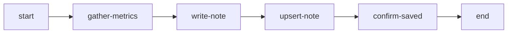
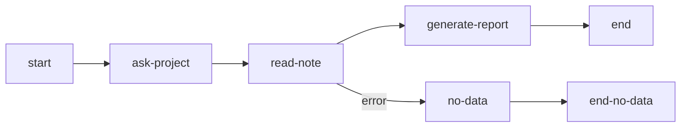

Notes provide persistent key-value storage scoped to each user. Data saved in notes survives across workflow executions, enabling preferences, accumulated results, and cross-workflow data pipelines.

## Use Cases

- **User preferences**: Store commit style, preferred region, coding conventions
- **Data accumulation**: Weekly analysis results compared over time
- **Cross-workflow pipelines**: Collector workflow saves data, Reporter workflow reads it
- **Session continuity**: Intermediate results survive session archiving

## MCP Tool

The `notes` MCP tool provides these actions for agent access:

```json
notes({ action: "save", key: "commit-style", value: "conventional", tags: ["preferences"] })
notes({ action: "get", key: "commit-style" })
notes({ action: "list", tag: "preferences" })
notes({ action: "history", key: "commit-style" })
notes({ action: "delete", key: "commit-style" })
notes({ action: "stats" })
```

| Action    | Purpose                                   |
| --------- | ----------------------------------------- |
| `save`    | Create or update a note                   |
| `get`     | Read note content by key                  |
| `list`    | List a page of notes with tag/key filters |
| `history` | View version history of a note            |
| `delete`  | Soft delete a note                        |
| `stats`   | Usage statistics and quota info           |

### Key Format

Keys accept alphanumeric characters, underscore, and hyphen. Length: 1-100 characters.

```
my-config          # valid
project_settings   # valid
2024-report        # valid
```

### Limits and pagination

Per-note size, total storage, and retained-version limits come from the active server policy. Use
`notes({ action: "stats" })` for the current total storage limit and usage; rejected writes report
the enforced size or quota boundary. The fixed key and tag syntax limits remain visible in the MCP
schema and validation errors.

`list` returns a page rather than the complete collection. Use `limit` and `offset`, and compare the
returned notes with `total` to determine whether another page is needed.

List and history entries contain short previews, not complete note text. Use `get` to read the
current value, or pass `version` to read a specific version; opening a version in the Web UI also
reads its full text. A truncated preview does not mean the stored value was truncated.

## Automatic Node Types

Three node types execute note operations without agent interaction. They run server-side and continue to the next node automatically.

The snippets are declaration fragments. Define their connection targets and producing agent nodes in the containing graph. Bare template names such as projectName, date, analysisData and metricsData require declared registry globals written before use; node-local values use `node-id.field` instead.

### read-note

Reads notes matching filter criteria into a context variable:

```json
{
  "type": "read-note",
  "id": "load-metrics",
  "outputVariable": "metricsNotes",
  "filter": {
    "tag": "metrics",
    "keyPattern": "metrics-"
  },
  "connections": {
    "default": "process-data",
    "error": "no-data-handler"
  }
}
```

| Property            | Required | Description                                                                  |
| ------------------- | -------- | ---------------------------------------------------------------------------- |
| `outputVariable`    | Yes      | Context variable to store results                                            |
| `filter.tag`        | No       | Filter by exact tag                                                          |
| `filter.keyPattern` | No       | Key search term (contains matching, not a prefix guarantee)                  |
| `filter.keySearch`  | No       | Search in key (contains)                                                     |
| `singleMode`        | No       | Object only when the returned page has exactly one match; otherwise an array |
| `connections.error` | No       | Error handler node                                                           |

The returned value above is local: use `{{load-metrics.metricsNotes}}`, not bare `{{metricsNotes}}`. The automatic node reads one default-sized page, not an unbounded collection; use paged MCP `notes list` when completeness across a large collection is required.

### write-note

Writes data from context to a note:

```json
{
  "type": "write-note",
  "id": "save-results",
  "key": "results-{{projectName}}-{{date}}",
  "source": "{{analysisData}}",
  "tags": ["analysis", "{{projectName}}"],
  "connections": {
    "default": "next-step"
  }
}
```

| Property    | Required | Description                             |
| ----------- | -------- | --------------------------------------- |
| `key`       | No\*     | Note key (required in single mode)      |
| `source`    | Yes      | Context variable or template with value |
| `tags`      | No       | Tags to assign                          |
| `batchMode` | No       | Process array of `[{key, value, tags}]` |

When `source` resolves to an object or array, the value is auto-serialized to a JSON string. Strings pass through unchanged, numbers and booleans convert to their string form.

In batch mode, `source` is a raw context path such as `collect-items.items`, not `{{collect-items.items}}`.

### upsert-note

Finds existing note by search criteria or creates a new one:

An existing search selects the first matching note, not a proved unique match. Use a sufficiently specific key/tag scheme; a broad tag shared across projects is not a project identity.

```json
{
  "type": "upsert-note",
  "id": "update-latest",
  "search": { "tag": "latest-metrics-{{projectName}}" },
  "keyTemplate": "latest-metrics-{{projectName}}",
  "value": "{{metricsData}}",
  "tags": ["metrics", "latest-metrics-{{projectName}}"],
  "connections": {
    "default": "next-step"
  }
}
```

| Property            | Required | Description                      |
| ------------------- | -------- | -------------------------------- |
| `search.tag`        | No       | Search by tag                    |
| `search.keyPattern` | No       | Search within key                |
| `keyTemplate`       | Yes      | Key for new note if not found    |
| `value`             | Yes      | Context variable with note value |
| `tags`              | No       | Tags to assign                   |
| `outputVariable`    | No       | Store upsert result in context   |

When `value` resolves to an object or array, the value is auto-serialized to a JSON string.

:::tip
All filter, key, and tag parameters support `{"{{variable}}"}` template expressions resolved from
execution context.
:::

## Template Syntax

Reference note content in directive and completionCondition fields using `{{note:KEY}}` syntax:

```
Analyze the project using this configuration: {{note:project-config}}
```

Note content is injected before the agent sees the directive. Missing notes produce `[NOTE NOT FOUND: KEY]`.

Template variables inside note content are resolved after injection:

```
// Note "greeting" contains: "Hello, {{userName}}!"
// Directive: {{note:greeting}}
// Agent sees: "Hello, Alice!" (when userName="Alice")
```

## Tutorial: Cross-Workflow Data Pipeline

This example shows two workflows communicating through Notes: a Collector saves project metrics, a Reporter reads and analyzes them.

### Workflow 1: Metrics Collector

Collects metrics and saves them as notes:



Key nodes:

**write-note** saves raw metrics with a timestamped key. The `source` field references agent output using dot-path syntax — objects and arrays are auto-serialized to JSON:

```json
{
  "type": "write-note",
  "id": "write-metrics-note",
  "key": "metrics-{{gather-metrics.projectName}}-{{gather-metrics.collectionDate}}",
  "source": "{{gather-metrics.metrics}}",
  "tags": ["metrics", "{{gather-metrics.projectName}}", "raw-data"]
}
```

**upsert-note** maintains a "latest" reference:

```json
{
  "type": "upsert-note",
  "id": "upsert-latest-summary",
  "search": { "tag": "latest-metrics-{{gather-metrics.projectName}}" },
  "keyTemplate": "latest-metrics-{{gather-metrics.projectName}}",
  "value": "{{gather-metrics.metrics}}",
  "tags": [
    "metrics",
    "{{gather-metrics.projectName}}",
    "latest-metrics-{{gather-metrics.projectName}}"
  ]
}
```

### Workflow 2: Metrics Reporter

Reads saved metrics and generates a report:



**read-note** loads a page of matching metrics by tag and key search:

```json
{
  "type": "read-note",
  "id": "load-all-metrics",
  "outputVariable": "metricsNotes",
  "filter": {
    "tag": "metrics",
    "keyPattern": "metrics-"
  }
}
```

The report directive uses `{{note:KEY}}` to inject the latest snapshot. Dot-path syntax references agent output from previous nodes:

```
Generate a metrics report.

Latest metrics snapshot:
{{note:latest-metrics-{{ask-project.projectName}}}}

Matching metrics page:
{{load-all-metrics.metricsNotes}}
```

### Running the Pipeline

1. Start the Metrics Collector workflow and provide project metrics.
2. Automatic write-note/upsert-note nodes save the data, using a project-specific search for the latest note.
3. Start the Metrics Reporter workflow for the same project.
4. Read the matching page and use `{{note:KEY}}` for the full latest snapshot; collect additional pages through MCP when needed.
5. Compare the collected dates, explicitly reporting any incomplete collection.

Use a unique collection key when each run must retain a separate note. Reusing a key creates a new version of that note; upsert-note updates the matching latest note rather than proving that a new collection was saved separately.

## Web UI

Notes are managed through the web interface at the Notes page (accessible from sidebar navigation):

- Browse notes with key, tags, size, and preview
- Filter by tag or search by key name
- Create, edit, and delete notes
- View version history — a past version on its own, beside the current one, or as a line-by-line
  difference — and restore it; the history dialog is the same one playbooks and global settings use
- Monitor quota usage

## Related

- [MCP Tools Reference](/docs/reference/tools/) — `notes` tool actions and schemas
- [Nodes](/docs/concepts/nodes/) — Automatic node type configuration
- [Templates](/docs/concepts/templates/) — Template variable syntax including `{{note:KEY}}`
