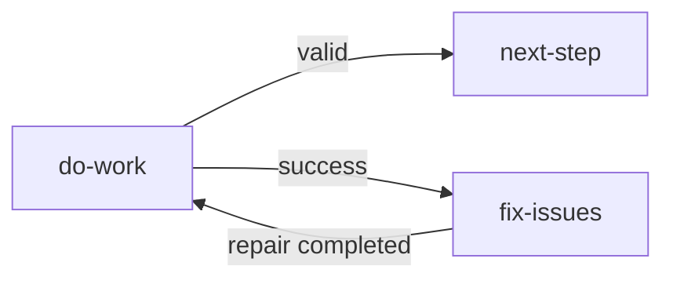
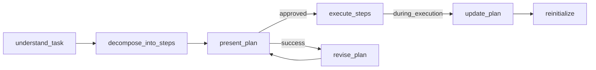
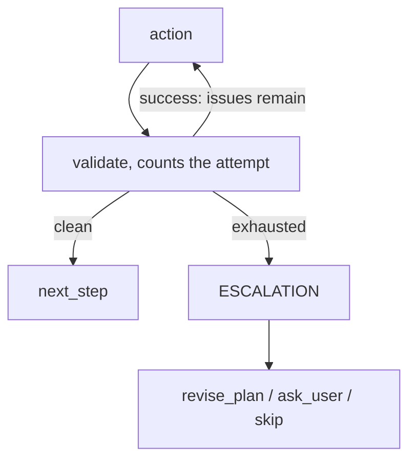
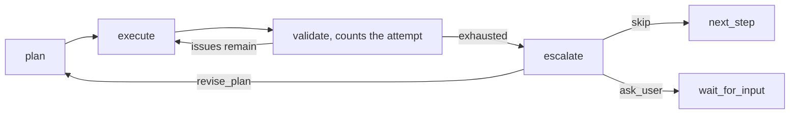

This guide covers workflow creation from scratch, including common patterns, validation loops, and best practices.

## Quick Start

1. Define the workflow goal and main responsibilities.
2. Design the node graph and its decision boundaries.
3. Create JSON with complete node definitions.
4. Validate connections, declarations and intended routes.
5. Save through the authorized MCP operation.

## Workflow Structure

Every workflow needs:

```jsonc
{
  "id": "my-workflow",
  "metadata": {
    "name": "Human Readable Name",
    "version": "1.0.0",
    "description": "What this workflow does",
  },
  "nodes": [
    // start node (exactly one)
    // action nodes — the node that has the evidence carries the cases that route it
    // condition nodes — for a decision several nodes share, or one that stands on its own
    // end node (at least one)
  ],
}
```

## Common Patterns

### Validation Loop

Use when you need to verify results and retry on failure. The node that produced the result reports
whether it holds and routes on that answer; the repair owner fixes confirmed findings before the next check:



```json
[
  {
    "id": "do-work",
    "type": "agent-directive",
    "directive": "Complete the task",
    "completionCondition": "Task completed",
    "inputSchema": {
      "type": "object",
      "properties": {
        "result_valid": { "type": "string", "enum": ["yes", "no"] }
      },
      "required": ["result_valid"]
    },
    "cases": [
      {
        "when": {
          "operator": "eq",
          "left": { "contextPath": "do-work.result_valid" },
          "right": "yes"
        },
        "output": "valid"
      }
    ],
    "connections": {
      "success": "fix-issues",
      "valid": "next-step"
    }
  },
  {
    "id": "fix-issues",
    "type": "agent-directive",
    "directive": "Fix the issues found",
    "completionCondition": "Every issue reported by the previous attempt is fixed",
    "connections": { "success": "do-work" }
  }
]
```

These are node fragments in a containing workflow, not a complete graph. Named targets must exist. Diagnose and repair the cause before repeating; retain independent review when the contract requires it. A counter is needed only for a real budget or artifact consumer; declare its numeric registry entry with a default and update it through expressions.

### Branching by Action Type

Use when the workflow has different paths for different scenarios. The answer that selects the
branch is the one this step just produced, so the case belongs on the step itself:

```json
{
  "id": "get-action",
  "type": "agent-directive",
  "directive": "Ask user: create new or edit existing?",
  "completionCondition": "The user stated create or edit",
  "inputSchema": {
    "type": "object",
    "properties": {
      "action": { "type": "string", "enum": ["create", "edit"] }
    },
    "required": ["action"]
  },
  "cases": [
    {
      "when": {
        "operator": "eq",
        "left": { "contextPath": "get-action.action" },
        "right": "create"
      },
      "output": "create"
    }
  ],
  "connections": {
    "success": "edit-branch",
    "create": "create-branch"
  }
}
```

The cases are evaluated against the context after the node's answer has been merged, so the answer
is readable by bare name when it is a declared global (`{{action}}`) and as `<node-id>.field` when
it is a node-local output (`get-action.action`). `success` is the fallback: a run whose answer
matches no case takes the edit branch.

**Decide on the node that has the evidence.** Every extra node is a hop the reader must follow and
another place where the decision and the evidence can drift apart — a graph that decides where it
knows is shorter to read and cannot route on a stale copy. The same holds for a single-purpose
arithmetic step: a counter or a derived total is an `expressions` entry on the node that already
runs there rather than a node of its own.

Keep a separate `condition` or `expression` node when it reads better alone — when several producers
share one decision, when the condition reads state no single node produced, when a named decision
point helps the reader of the process view, or when the computation deserves its own place in the
route. Written that way, the same branch is two nodes: `get-action` keeps only
`"connections": { "success": "route-action" }`, and the decision moves to its own node.

```json
{
  "id": "route-action",
  "type": "condition",
  "cases": [
    {
      "when": {
        "operator": "eq",
        "left": { "contextPath": "get-action.action" },
        "right": "create"
      },
      "output": "create"
    }
  ],
  "connections": {
    "create": "create-branch",
    "default": "edit-branch"
  }
}
```

A `condition` or `expression` node whose only job is to route or count what the preceding node
already knows is avoidable routing scaffolding — fold it into that node.

### User Approval Gate

Use for critical actions that need confirmation. The node that asks holds the answer, so it also
routes on it — and a run that was not approved falls through `success` to the revision:

```json
{
  "id": "show-plan",
  "type": "agent-directive",
  "directive": "Present plan to user and ask for approval",
  "completionCondition": "The user answered yes or no",
  "inputSchema": {
    "type": "object",
    "properties": {
      "approved": { "type": "string", "enum": ["yes", "no"] },
      "feedback": { "type": "string" }
    },
    "required": ["approved"],
    "if": { "properties": { "approved": { "const": "no" } }, "required": ["approved"] },
    "then": {
      "required": ["feedback"],
      "properties": { "feedback": { "type": "string", "minLength": 1 } }
    }
  },
  "cases": [
    {
      "when": {
        "operator": "eq",
        "left": { "contextPath": "show-plan.approved" },
        "right": "yes"
      },
      "output": "approved"
    }
  ],
  "connections": {
    "success": "revise-plan",
    "approved": "proceed"
  }
}
```

## Input Schema Patterns

### Yes/No Response

```json
{
  "inputSchema": {
    "type": "object",
    "properties": {
      "result": { "type": "string", "enum": ["yes", "no"] },
      "details": { "type": "string" }
    },
    "required": ["result"]
  }
}
```

### Numeric Count

```json
{
  "inputSchema": {
    "type": "object",
    "properties": {
      "count": { "type": "number", "minimum": 0 },
      "total": { "type": "number", "minimum": 1 }
    },
    "required": ["count", "total"]
  }
}
```

### Array of Items

```json
{
  "inputSchema": {
    "type": "object",
    "properties": {
      "items": {
        "type": "array",
        "items": { "type": "string" },
        "minItems": 1
      }
    },
    "required": ["items"]
  }
}
```

### Enum Choice (Multiple Options)

```json
{
  "inputSchema": {
    "type": "object",
    "properties": {
      "action": {
        "type": "string",
        "enum": ["create", "edit", "delete", "cancel"]
      },
      "reason": { "type": "string" }
    },
    "required": ["action"]
  }
}
```

### File Path with Pattern

```json
{
  "inputSchema": {
    "type": "object",
    "properties": {
      "file_path": {
        "type": "string",
        "pattern": "^[a-zA-Z0-9/_.-]+\\.(json|yaml|yml)$"
      }
    },
    "required": ["file_path"]
  }
}
```

## Condition Operators

A condition node's `cases` each pair one of these condition objects with the connection key it
selects.

| Operator   | Description         | Example                        |
| ---------- | ------------------- | ------------------------------ |
| `eq`       | Equal               | `"right": "value"`             |
| `neq`      | Not equal           | `"right": "value"`             |
| `lt`       | Less than           | `"right": 10`                  |
| `gt`       | Greater than        | `"right": 0`                   |
| `lte`      | Less or equal       | `"right": 100`                 |
| `gte`      | Greater or equal    | `"right": 1`                   |
| `contains` | String/array member | `"right": "urgent"`            |
| `and`      | Logical AND         | `"conditions": [...]`          |
| `or`       | Logical OR          | `"conditions": [...]`          |
| `not`      | Negation            | `"condition": {...}`           |
| `exists`   | Variable exists     | `"value": { "contextPath": …}` |

### Complex Condition Example

This fragment assumes prepare-items returns local status and count, and its targets exist in the containing workflow.

```json
{
  "id": "check-ready",
  "type": "condition",
  "cases": [
    {
      "when": {
        "operator": "and",
        "conditions": [
          {
            "operator": "eq",
            "left": { "contextPath": "prepare-items.status" },
            "right": "ready"
          },
          {
            "operator": "gt",
            "left": { "contextPath": "prepare-items.count" },
            "right": 0
          }
        ]
      },
      "output": "ready"
    }
  ],
  "connections": {
    "ready": "process-items",
    "default": "wait"
  }
}
```

## Declaring Knowledge as Globals

Declare reusable knowledge as global variables in the workflow `variableRegistry` with a `default` value:

```json
{
  "variableRegistry": {
    "quality_rules": {
      "type": "string",
      "description": "Reusable quality rules the agent applies across steps",
      "default": "Rule 1: ... Rule 2: ..."
    },
    "validation_checklist": {
      "type": "string",
      "description": "Checklist the agent verifies before completing a step",
      "default": "Check 1: ... Check 2: ..."
    }
  }
}
```

Reference in directives:

```json
{
  "directive": "Follow these rules: {{quality_rules}}"
}
```

:::tip
Registry defaults suit stable workflow-owned text. Read applicable project rules at their actual owner; shared playbooks and materialized references retain their own contracts. Delivery does not prove compliance.
:::

## Validation Checklist

Before saving, verify:

1. **Structure**
   - Exactly one start node
   - At least one end node
   - All node IDs unique
   - All connections point to existing nodes

2. **Reachability**
   - Ordinary nodes are reachable from start; declared teleport entries are checked separately
   - No orphan nodes
   - Routes finish or enter an intended wait, repair or escalation; no blind unchanged retry

3. **Node Definitions**
   - `directive` not empty
   - `completionCondition` defined
   - `connections.success` specified — it is the output a directive takes when no case holds
   - `inputSchema` is valid JSON Schema
   - A directive's `cases` and `expressions` obey the rules below: each case names a connection key
     that is not `success`, `error` or `timeout`, and each expression assigns a declared global

4. **Routing**
   - A `condition` node has at least one case and a `connections.default`
   - Every case names a key of `connections`, and never `error` or `timeout`
   - Every authored output is named by a case — the default output and the control outputs
     `error`/`timeout` need none
   - Operator is valid
   - Each expression assigns a variable declared in `variableRegistry`

## Saving Workflows

### Create New

```typescript
mcp__moira__manage({
  action: "create",
  workflow: {
    id: "my-workflow",
    metadata: { name: "...", version: "1.0.0", description: "..." },
    nodes: [...]
  }
})
```

### Edit Existing

```typescript
mcp__moira__manage({
  action: "edit",
  workflowId: "my-workflow",
  changes: {
    metadata: { version: "1.1.0" },
    updateNodes: [{ nodeId: "step-1", changes: { directive: "New text" } }],
  },
});
```

### File Upload

```typescript
// For agents with file system access
const { uploadUrl } = await mcp__moira__token({ action: "upload" });
// Upload JSON file to uploadUrl
```

## Agent Capabilities Detection

Different agents have different capabilities. Design workflows to detect and adapt:

### Capability Categories

| Capability  | Examples                  | Detection Method             |
| ----------- | ------------------------- | ---------------------------- |
| File System | Read, Write, Create files | Ask agent to confirm access  |
| Web Access  | Fetch URLs, Search        | Check if agent has web tools |
| MCP Only    | Moira tools only          | Default assumption           |

### Detection Pattern

```json
{
  "id": "detect-capabilities",
  "completionCondition": "Current capabilities checked honestly within host access policy",
  "type": "agent-directive",
  "directive": "Report your capabilities: can you access the file system? can you fetch URLs?",
  "inputSchema": {
    "type": "object",
    "properties": {
      "has_file_access": { "type": "boolean" },
      "has_web_access": { "type": "boolean" }
    },
    "required": ["has_file_access", "has_web_access"]
  },
  "connections": { "success": "route-by-capabilities" }
}
```

### Conditional Branching

Capability routing is the case for a node of its own. Several steps reach the same decision — every
branch that needs a file or a URL asks the same question — so one named `route-by-capabilities` node
holds it once instead of repeating the same case on each node that arrives there, and the reader of
the process view sees where the flow splits:

```json
{
  "id": "route-by-capabilities",
  "type": "condition",
  "cases": [
    {
      "when": {
        "operator": "eq",
        "left": { "contextPath": "detect-capabilities.has_file_access" },
        "right": true
      },
      "output": "file-access"
    }
  ],
  "connections": {
    "file-access": "file-based-flow",
    "default": "mcp-only-flow"
  }
}
```

:::tip
Provide only supported fallback paths. MCP availability depends on host configuration and access policy; report a blocker when a required capability is unavailable.
:::

## Planning Pattern

Use when workflow needs to create and execute a plan with user approval and revision capability.

### The Problem

Workflows often need a planning phase, but:

- Plans are created once and never revised
- Requirements for plan quality are not formalized
- No ability to adapt the plan during execution
- Agent loses context in long sessions

### Pattern Structure



### Key Components

1. **variableRegistry.plan_writing_requirements** — rules for writing plans (agent sees when creating)
2. **decompose_into_steps** — directive with `{{plan_writing_requirements}}` for plan creation
3. **user_approval_branch** — `present_plan` routes on the answer it collected: approved → execute,
   otherwise revise_plan → present_plan
4. **update_during_execution** — ability to adapt plan during execution

### Plan Writing Requirements

The main problem: agent loses context (session archival, simple forgetting). Plans must be written so any step can be given to an agent WITHOUT the rest of the plan — and it can execute.

| Requirement                 | Why Important                         | Example                                                                    |
| --------------------------- | ------------------------------------- | -------------------------------------------------------------------------- |
| Flat linear list            | Easier to track without hierarchy     | 1, 2, 3... not 1.1, 1.2, 1.2.1                                             |
| Self-sufficient steps       | Any step executable without context   | "Step 3: Create file X.ts with function Y" not "Continue work"             |
| Explicit actions            | Not "as usual", but specifically      | "Make commit" in every step where needed                                   |
| Measurable result           | Easy to verify completion             | "expected_output: file X.ts created and contains function Y"               |
| Independence                | Minimal dependencies between steps    | Step 4 shouldn't require knowledge of step 2 details                       |
| Full file paths             | Agent shouldn't guess                 | `/full/path/to/file.json`, not "in appropriate folder"                     |
| Redundancy where it applies | Repeat what this item genuinely needs | "Make commit" repeated in an item that ends in a commit, not in every item |

### Item Atomicity

Each plan or task item must be self-contained. An agent often receives ONE item's directive in isolation — without the rest of the plan — so the item must carry everything needed to execute it:

- Restate the nuances the item depends on.
- Repeat the relevant original requirement inside the item.
- Repeat a cross-cutting action (progress report, run tests, commit) in the items it genuinely applies to.

Do not rely on an executor remembering other items, so an item that leans on "as above" is unexecutable. The answer is what the executor needs when it is alone, judged item by item — not unconditional duplication: repeated text becomes a second source of truth that drifts, and an item required to carry everything grows until it carries the deliverable itself. See [Redundancy Required in Every Plan Item](/docs/patterns/anti-patterns/).

```json
{
  "id": "execute-plan-item",
  "type": "agent-directive",
  "directive": "Execute one plan item.\n\nThe item text is self-contained: it states the original requirement, the files to read/modify with full paths, and the cross-cutting actions (run tests, make commit) that apply to THIS item.\n\nDo NOT assume any context from other items.",
  "completionCondition": "Item executed, tests run, and commit made as stated in the item",
  "connections": { "success": "next-item" }
}
```

:::tip
Two related patterns build on this guide: the [Replan Pattern](/docs/patterns/replan/) revises a
multi-step plan mid-execution, and the [Completeness Self-Review
Pattern](/docs/patterns/self-review/) verifies every requirement against the real artifact before
delivery.
:::

### Implementation Example

The following complete workflow covers plan drafting and approval only; execution and independent review are separate domain responsibilities to add when the task contract requires them. The same owner revises the canonical plan after feedback. No path, deployment or VCS action is authorized by this example.

```json
{
  "id": "c4786f09-0769-4437-84b7-b032eab5396f",
  "metadata": {
    "name": "Draft and approve a plan",
    "version": "1.0.0",
    "description": "Prepare a scoped plan and obtain the user's actual approval"
  },
  "variableRegistry": {
    "plan": { "type": "string", "description": "Current canonical plan" }
  },
  "nodes": [
    { "id": "start", "type": "start", "connections": { "default": "prepare-plan" } },
    {
      "id": "prepare-plan",
      "type": "agent-directive",
      "directive": "Read the actual requirements and applicable project instructions. Prepare a plan of verifiable outcomes with dependency order, source owners, relevant validation and authority limits. {{#if present-plan.user_feedback}}Revise the plan against the user's feedback: {{present-plan.user_feedback}}{{/if}}",
      "completionCondition": "The current plan covers the requirements without claiming unperformed work or unauthorized effects",
      "inputSchema": {
        "type": "object",
        "globalInputs": ["plan"],
        "properties": {},
        "required": ["plan"]
      },
      "connections": { "success": "present-plan" }
    },
    {
      "id": "present-plan",
      "type": "agent-directive",
      "directive": "Present {{plan}} and wait for the user's actual answer. Record plan_approved=yes only for explicit approval of this version. Otherwise record no and the user's feedback; do not repair the plan at this gate.",
      "completionCondition": "The user has actually approved this plan or supplied the feedback recorded for revision",
      "inputSchema": {
        "type": "object",
        "properties": {
          "plan_approved": { "type": "string", "enum": ["yes", "no"] },
          "user_feedback": { "type": "string" }
        },
        "required": ["plan_approved"],
        "if": {
          "properties": { "plan_approved": { "const": "no" } },
          "required": ["plan_approved"]
        },
        "then": {
          "required": ["user_feedback"],
          "properties": { "user_feedback": { "type": "string", "minLength": 1 } }
        }
      },
      "cases": [
        {
          "when": {
            "operator": "eq",
            "left": { "contextPath": "present-plan.plan_approved" },
            "right": "yes"
          },
          "output": "approved"
        }
      ],
      "connections": { "success": "prepare-plan", "approved": "end" }
    },
    { "id": "end", "type": "end", "connections": {} }
  ]
}
```

### Showing the Plan as Progress

A plan or checklist kept in variables is invisible to whoever is watching the run unless the process
view is told where it lives. Bind the list on the block whose steps work through it: `list` names the
paths of the array (`items`), the title inside one item (`title`), the index in progress (`current`,
counted from `indexBase`), the finished count (`done`) and the total (`total`), and the run then
reports done/total and the item being worked on.

```json
{
  "id": "execute",
  "label": "Execute",
  "content": { "summary": "Work through the approved plan, one item at a time" },
  "list": {
    "items": "decompose-into-steps.steps",
    "title": "action",
    "current": "current_step_index",
    "total": "total_steps"
  }
}
```

At least one of `items`, `current` and `total` is required; `total` defaults to the length of
`items` and `done` to `current − indexBase`. See [Workflows](/docs/concepts/workflows/) for the
complete field reference.

### Update Plan During Execution

Use [Process Revision](/docs/patterns/process-revision/) and [Replan](/docs/patterns/replan/): one authorized teleport enters the existing revision owner, and the new version passes normal review and any required approval. Preserve completed item positions and evidence; derive dependent totals from the actual plan instead of manually resetting progress in a separate relay turn.

## Escalation Pattern

Use when workflow has validation loops that can get stuck. Provides escape mechanism after repeated failures.

### The Problem

When agent is stuck in a validation loop:

- Retries forever without progress
- Same errors repeat
- No way to break out
- User waits indefinitely

### Pattern Structure



### When to Apply

- Workflows with planning (robust-task, development)
- Workflows with result validation (workflow-management, test-generation)
- Any "do → check → retry" cycles

### Escalation Options

| Option        | When to Use            | Example                            |
| ------------- | ---------------------- | ---------------------------------- |
| `revise_plan` | Current plan is flawed | Tests fail because design is wrong |
| `ask_user`    | Need human decision    | Unclear requirements               |
| `skip`        | Step is non-critical   | Optional enhancement               |

### Implementation Example

The following example illustrates a chosen budget: its containing workflow declares numeric step_retry with description and default: 0. This budget is not universal. Check a clean result before exhaustion; an independent blocker requires escalation rather than blind repetition. The step that checks the result owns the whole decision: it counts the attempt in `expressions`, and
its cases send a clean result forward, an exhausted budget to the escalation, and everything else
back for another attempt through `success`.

```json
[
  {
    "id": "validate-step",
    "type": "agent-directive",
    "directive": "ONLY CHECK the result of the step. Count any issues found. Attempt {{step_retry}}.",
    "completionCondition": "Issue count reported",
    "inputSchema": {
      "type": "object",
      "properties": {
        "issues_count": { "type": "number", "minimum": 0 }
      },
      "required": ["issues_count"]
    },
    "expressions": ["step_retry = step_retry + 1"],
    "cases": [
      {
        "when": {
          "operator": "eq",
          "left": { "contextPath": "validate-step.issues_count" },
          "right": 0
        },
        "output": "clean"
      },
      {
        "when": { "operator": "gte", "left": { "contextPath": "step_retry" }, "right": 3 },
        "output": "exhausted"
      }
    ],
    "connections": {
      "success": "retry-action",
      "clean": "next-step",
      "exhausted": "notify-escalation"
    }
  },
  {
    "id": "notify-escalation",
    "type": "user-notification",
    "message": "⚠️ *The step keeps failing its check*\n\nChoose: go back and revise the plan, ask a person for help with the specific problem, or skip the step if it is optional.",
    "format": "markdown",
    "connections": { "default": "ask-escalation-decision", "error": "ask-escalation-decision" }
  },
  {
    "id": "ask-escalation-decision",
    "type": "agent-directive",
    "directive": "Step failed after {{step_retry}} attempts.\n\nAsk user for decision:\n1. **revise_plan** — go back to planning and reconsider approach\n2. **ask_user** — request human help with specific problem\n3. **skip** — skip this step and continue\n\n`decision` records the user's own choice: each of the three routes elsewhere, so an assumed answer picks a route on their behalf.",
    "completionCondition": "The user chose one of the three options",
    "inputSchema": {
      "type": "object",
      "properties": {
        "escalation_decision": {
          "type": "string",
          "enum": ["revise_plan", "ask_user", "skip"]
        },
        "user_input": { "type": "string" }
      },
      "required": ["escalation_decision"],
      "if": {
        "properties": { "escalation_decision": { "const": "ask_user" } },
        "required": ["escalation_decision"]
      },
      "then": {
        "required": ["user_input"],
        "properties": { "user_input": { "type": "string", "minLength": 1 } }
      }
    },
    "cases": [
      {
        "when": {
          "operator": "eq",
          "left": { "contextPath": "ask-escalation-decision.escalation_decision" },
          "right": "revise_plan"
        },
        "output": "revise"
      },
      {
        "when": {
          "operator": "eq",
          "left": { "contextPath": "ask-escalation-decision.escalation_decision" },
          "right": "skip"
        },
        "output": "skip"
      }
    ],
    "connections": {
      "success": "handle-user-help",
      "revise": "revise-plan",
      "skip": "mark-step-skipped"
    }
  }
]
```

Three outcomes need no extra node either: two cases name the branches that leave the ordinary path,
and `success` carries the third. The enum guarantees there is no fourth.

### Combining with Planning Pattern

When using both Planning and Escalation patterns:



The `revise_plan` option loops back to the Planning phase, allowing the agent to reconsider the approach based on what it learned from failures.

:::tip
Choose a retry budget only from applicable policy, not an arbitrary complexity estimate. Skip applies only to an explicitly optional condition; it cannot waive required review, approval or external-effect authority.
:::

## Production Patterns

The examples below illustrate individual responsibilities. Select them for their real consumers and applicable authority.

### Express/Full Mode Branching

Route to simplified or full flow based on task complexity. The step that establishes the mode is the
step that routes on it:

```
[get-requirements] → express → [express-flow]
                   → success → [full-flow]
```

```json
{
  "id": "get-requirements",
  "type": "agent-directive",
  "directive": "Collect the requirements and decide whether this task fits the express mode.",
  "completionCondition": "Requirements collected and a mode chosen",
  "inputSchema": {
    "type": "object",
    "properties": {
      "development_mode": { "type": "string", "enum": ["express", "full"] }
    },
    "required": ["development_mode"]
  },
  "cases": [
    {
      "when": {
        "operator": "eq",
        "left": { "contextPath": "get-requirements.development_mode" },
        "right": "express"
      },
      "output": "express"
    }
  ],
  "connections": {
    "success": "analyze-and-plan",
    "express": "express-implementation"
  }
}
```

### Plan Refinement Loop

Present plan → get feedback → refine → confirm:

```
[present-plan] → approved → [continue]
               → success  → [refine] → [confirm] → [continue]
```

### Numeric Validation Pattern (Recommended)

Use a finding count when the route genuinely depends on the number of confirmed findings. The reviewer must inspect the actual artifact against its requirements and explain findings in one canonical report. A count can be misstated just like a boolean; the engine validates the answer's shape and evaluates the route, not the truth of the review.

```json
{
  "id": "validate-result",
  "type": "agent-directive",
  "directive": "Inspect the real artifact against its requirements. Write the complete current findings and reasoning to the agreed report, then return its actual actionable finding count. Do not repair at this independent gate.",
  "completionCondition": "Required independent review completed on an unchanged artifact and current findings recorded honestly",
  "inputSchema": {
    "type": "object",
    "properties": {
      "issues_count": { "type": "integer", "minimum": 0 }
    },
    "required": ["issues_count"]
  },
  "cases": [
    {
      "when": {
        "operator": "eq",
        "left": { "contextPath": "validate-result.issues_count" },
        "right": 0
      },
      "output": "clean"
    }
  ],
  "connections": { "success": "fix-issues", "clean": "next-step" }
}
```

This is a node fragment: the report destination and named target nodes belong to its containing workflow. A reasoned pass/repair verdict may serve another workflow better. Do not replace qualitative assessment with an arbitrary numeric score or require counts that nobody consumes.

### Numeric Validation with Test Counts

Report counts only from a real selected test run when the report's reader needs them. Zero failed tests alone does not prove that the intended tests ran: an empty selection, skips, an infrastructure refusal or a failed process may also produce zero. Inspect the actual runner outcome and selected coverage before choosing a pass route; preserve failures and blockers in the evidence.

### User Notifications

Notifications keep users informed during long-running workflows. Use them strategically - too many notifications become noise.

#### When to Use Notifications

| Scenario                | Why Notify                                  |
| ----------------------- | ------------------------------------------- |
| **Plan ready**          | User sees what will be done, can approve it |
| **User input required** | User knows to check and respond             |
| **Critical errors**     | Immediate awareness of blockers             |
| **Task completion**     | User can review results                     |

#### When NOT to Use

- Short workflows (< 5 minutes total)
- Between every small step
- For internal validation loops
- When error is auto-recoverable

#### What a message says

A notification is all the person sees of the run, often on a phone. The engine already opens every
message with the flow name and the run's task, linked to the run page, so a message never repeats
them. Its first evidence-bearing intake establishes the actual task through the guarded
[execution task-name operation](/docs/concepts/workflows/#execution-task-name). An authorized
scope-changing responsibility updates that same name; arbitrary `execution_note` stays separate.

- The plan list comes from the list bound on the working block (see the progress reference), through
  `planList`: `full` at plan ready and at every finish, `progress` — the one-line `📝 done/total:
current item` — elsewhere. Never write the list into the message.
- No internal value reaches the reader: no path or file name, template syntax, node id, variable
  name, raw enum value, or counter without a title. A line written from the run's values comes from
  a one-sentence field the step writes for a person (a `…_summary` output whose directive says so);
  an enum value is worded through a template branch or by one message per outcome.
- Placement follows the operating mode. An interactive run is told before the question, with the
  choices explained in words. An autonomous run is never told that a decision is pending: at plan
  ready it hears that the work goes ahead, and after a decision the agent took, one message with
  what was decided and why, sent from the deciding node's own route.
- The run's last message connects straight to `end`, so its list shows no item still in progress.

The Workflow Management Flow checks every notification of a workflow it builds against these rules.

#### Pattern: Plan Ready

Announce the plan once it is ready, with the whole list. An interactive run asks for approval;
an autonomous run goes ahead:

```json
[
  {
    "id": "notify-plan-approval",
    "type": "user-notification",
    "message": "📋 *Plan ready for your approval* — approve it and the work goes ahead, or reject it with feedback and the plan is revised.",
    "format": "markdown",
    "planList": "full",
    "connections": { "default": "present-plan-to-user" }
  },
  {
    "id": "notify-work-started",
    "type": "user-notification",
    "message": "▶️ *Plan ready — work continues within the agreed scope.*",
    "format": "markdown",
    "planList": "full",
    "connections": { "default": "execute-step" }
  }
]
```

Place the first on the interactive branch of the mode route, the second on the autonomous one.

#### Pattern: Your Decision Needed

When automatic retries fail and a person has to decide, say which step, why, and what each choice
does:

```json
{
  "id": "notify-escalation",
  "type": "user-notification",
  "message": "⚠️ *Step needs your decision* — step “{{current_step_title}}” keeps failing its check: {{review-step.failure_summary}}\n\nChoose: try it again, change the plan, or finish with this step incomplete.",
  "format": "markdown",
  "connections": { "default": "ask-user-decision" }
}
```

`failure_summary` is a one-sentence field the reviewing step returns when it does not pass. In an
autonomous run the agent decides instead; the deciding node routes each outcome to its own message
sent after the decision:

```json
{
  "id": "notify-retry-decided",
  "type": "user-notification",
  "message": "🔁 *Decided for you* — trying the step again. {{ask-user-decision.decision_summary}}",
  "format": "markdown",
  "connections": { "default": "retry-step" }
}
```

#### Pattern: Completion

Say how the run ended, in words, with the plan's final state:

```json
{
  "id": "notify-completion",
  "type": "user-notification",
  "message": "🏁 *{{#eq delivery_status 'complete'}}Completed{{else}}Completed with open items{{/eq}}* — {{deliver-result.result_summary}}",
  "format": "markdown",
  "planList": "full",
  "connections": { "default": "end" }
}
```

:::tip
Set `connections.error` to the same target as `default` when notification failure must not block
the workflow. Without an error connection, total failure already continues through `default` with
an explicit `all_failed` result.
:::

:::note
For very long tasks (hours), consider periodic "still working" heartbeat notifications so user
knows the process is alive.
:::

## File Persistence Patterns

Files give large or shared artifacts a canonical address. Engine variables and execution history are already persisted; a file is not required merely because the conversation may be interrupted. Use the project's designated ignored workspace and respect filesystem and disclosure authority.

### Directory Structure

For example, after the workspace owner has declared and initialized global `workspace_path`:

```text
{{workspace_path}}/
├── process-id.txt
├── plan.md
├── steps/
│   └── result.md
└── final-report.md
```

See [Workspace](/docs/patterns/workspace/) for ownership, local ignore and materialization. These paths are examples, not a command to create a directory in the project root.

### Progress Tracking

The substantive workspace owner writes the execution ID alongside its other handoff artifacts, or delivers stable registry-backed files through `materialize`. Do not add an agent turn whose only job is copying an ID. A found handoff is not authority to resume a cancelled or unrelated execution; inspect the matching execution's current state first.

### Iteration Snapshots

Use separate snapshots when a real reviewer or recovery contract needs immutable versions. If their names use an iteration number, declare and initialize that numeric registry value and advance it in an existing expression owner. Do not add counters or snapshot files without a reader. Keep the reviewed bytes unchanged until the review returns.

### Context Offloading

Keep one detailed artifact in its canonical file and pass its path to consumers. The producer `produce-analysis` can return local `file_path`; a later complete node fragment can read it:

```json
{
  "id": "analyze-with-file-reference",
  "type": "agent-directive",
  "directive": "Read the relevant analysis at {{produce-analysis.file_path}} and complete the requested assessment against the actual requirements.",
  "completionCondition": "Analysis applied and substantive assessment completed with limitations reported",
  "connections": { "success": "next-step" }
}
```

### When to Use File Persistence

Use files for navigable reports, large bodies and artifacts shared with independent readers. Use persisted workflow values for small decisions and data with direct consumers. Provide a supported context-only path when files are optional; if the required file contract cannot be fulfilled, report the blocker instead of inventing a fallback result.

## User Input Problem

A schema accepts a submitted answer's shape; it does not establish that a human supplied it. When the workflow requires a real user decision, the agent must actually wait for that decision.

### The Problem

Presenting a plan and immediately submitting `approved: "yes"` invents the approval. A field named approval, a required evidence string or a humanGate annotation does not make an assumed answer legitimate.

### Solution: Say What the Answer Is

The field records the user's answer about the current artifact. This is a node fragment; its named targets must exist in the containing workflow:

```json
{
  "id": "approve-plan",
  "type": "agent-directive",
  "directive": "Present the current plan and wait for the user's actual answer. approved records that answer: without one there is nothing to submit. Record user_response_text verbatim. Rejection feedback belongs to the revision owner, not to an unreviewed repair at this gate.",
  "completionCondition": "The user actually responded about this version and the answer is recorded without assumption",
  "inputSchema": {
    "type": "object",
    "properties": {
      "approved": { "type": "string", "enum": ["yes", "no"] },
      "user_response_text": { "type": "string", "minLength": 1 }
    },
    "required": ["approved", "user_response_text"]
  },
  "cases": [
    {
      "when": {
        "operator": "eq",
        "left": { "contextPath": "approve-plan.approved" },
        "right": "yes"
      },
      "output": "approved"
    }
  ],
  "connections": { "success": "revise-plan", "approved": "proceed" }
}
```

### Key Techniques

- Identify whose decision it is, which version is being decided and where each answer leads.
- Wait using the host's supported user-input mechanism; do not equate displaying a question with receiving an answer.
- Record actual feedback so the revision owner can address it and repeat any required review.
- Do not infer authority to publish, deploy or perform another external effect from approval of a plan unless the caller's contract explicitly grants it.

### Split into Two Nodes (Alternative)

A separate presentation responsibility is useful only when it adds a distinct artifact or decision boundary. Merely separating display from answer collection does not prevent fabricated approval and needlessly adds turns:

```text
[prepare substantive artifact] → [obtain actual user decision] → approved / revision
```

Check the real wait, actual answer, rejection feedback and resulting route when validating a user-input interaction. JSON parsing alone cannot verify human participation.

## Best Practices

1. **One node = one responsibility** — keep required independent review separate from repair; a producer may run its own focused checks
2. **Decide where the evidence is** — the node that produced the answer carries the `cases` that
   route on it; a standalone `condition` is for a shared or named decision
3. **Clear directives** — start with verb: Create, Check, Fix
4. **Explicit negations** — "DO NOT fix, ONLY check"
5. **Use inputSchema** — define data a real consumer needs
6. **Reasoned validation** — choose observations and verdicts for the property being checked
7. **Retry for a reason** — diagnose the cause, change the work or follow an applicable budget; a counter alone does not stop a loop
8. **User approval gates** — for critical actions
9. **Self-documenting** — declare knowledge as variableRegistry defaults
10. **Graceful notifications** — channel errors should not block the workflow when notification is optional

## Related

- [Nodes](/docs/concepts/nodes/) — Node types reference
- [Templates](/docs/concepts/templates/) — Dynamic content
- [Tools](/docs/reference/tools/) — MCP tools reference
- [Replan Pattern](/docs/patterns/replan/) — Revise a multi-step plan mid-execution
- [Completeness Self-Review](/docs/patterns/self-review/) — Verify every requirement before delivery
