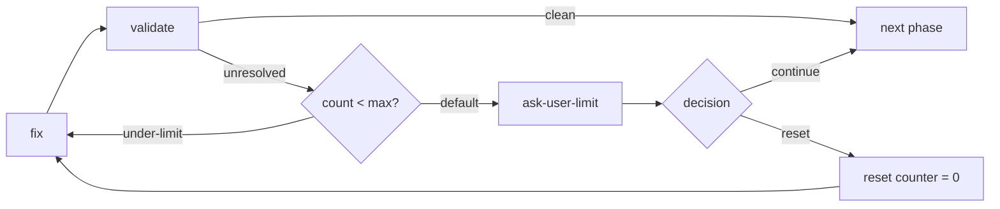

## Purpose

When automated retries fail, escalate to user for manual intervention. Prevents infinite loops and allows human judgment for complex failures.

The examples below are fragments whose targets must exist in the containing workflow. `current_iteration`, `validation_round` and `max_validation_rounds` serve an applicable retry policy only; declare them as numeric registry entries with initial defaults, as in Validation Loop. Error outputs belong to `handle-error`; a user decision belongs to the node that obtained the actual answer.

`continue` and `skip` apply only to explicitly optional or waivable conditions. They cannot bypass mandatory review, approval, access or external-effect authority. Preserve work and escalate at those blockers. Resetting a counter does not authorize replay of an external action with an uncertain outcome.

## Bounded-Loop Limit Escalation

When a bounded loop (a [validation loop](/docs/patterns/validation-loop/) or fix/retry cycle) reaches its iteration limit, the limit branch routes to an ask-user node. It never silently skips to the next phase — that hides unresolved issues from the user.

The ask-user node offers two decisions:

- **continue** — accept the current result and proceed despite remaining issues
- **reset** — zero the counter via an expression node and loop back to the fix step



The decision is captured with a two-option enum:

```json
{
  "type": "agent-directive",
  "id": "ask-user-limit",
  "directive": "Validation reached its limit of {{max_validation_rounds}} rounds with {{validate-result.issues_count}} issues remaining.\n\nAsk the user how to proceed:\n- continue: accept the current result and move on\n- reset: keep fixing (the round counter resets to 0)",
  "completionCondition": "User chose continue or reset",
  "inputSchema": {
    "type": "object",
    "properties": {
      "decision": { "type": "string", "enum": ["continue", "reset"] }
    },
    "required": ["decision"]
  },
  "connections": { "success": "route-limit-decision" }
}
```

Route the decision: `continue` proceeds to the next phase, `reset` runs the counter-reset expression node and loops back.

```json
{
  "type": "condition",
  "id": "route-limit-decision",
  "cases": [
    {
      "when": {
        "operator": "eq",
        "left": { "contextPath": "ask-user-limit.decision" },
        "right": "reset"
      },
      "output": "reset"
    }
  ],
  "connections": {
    "reset": "reset-validation-counter",
    "default": "next-phase"
  }
}
```

```json
{
  "type": "expression",
  "id": "reset-validation-counter",
  "expressions": ["validation_round = 0"],
  "connections": { "default": "fix-step" }
}
```

:::caution
Routing the limit branch straight to the next phase is the silent-skip anti-pattern. Always route
it through an ask-user node so the user keeps control over unresolved issues.
:::

## Structure

```
[action] → [verify] → failure → [check-retries] → retries<max → [retry]
                                               → retries>=max → [escalate-to-user]
```

## Implementation

### Retry Limit Check

```json
{
  "type": "condition",
  "id": "check-retry-limit",
  "cases": [
    {
      "when": {
        "operator": "lt",
        "left": { "contextPath": "current_iteration" },
        "right": 3
      },
      "output": "under-limit"
    }
  ],
  "connections": {
    "under-limit": "fix-and-retry",
    "default": "escalate-to-user"
  }
}
```

### Escalation Node

```json
{
  "type": "agent-directive",
  "id": "escalate-to-user",
  "completionCondition": "Actual user decision and any required repair instructions recorded without waiving mandatory authority or review",
  "directive": "Automated resolution failed after {{current_iteration}} attempts.\n\nProblem: {{handle-error.last_error}}\nAttempted fixes: {{handle-error.attempted_fix}}\n\nAsk user how to proceed:\n- Continue with current result as-is?\n- Reset counter and try fixing again?\n- Provide manual fix instructions?\n- Skip this step?\n- Abort workflow?",
  "inputSchema": {
    "type": "object",
    "properties": {
      "user_decision": { "type": "string", "enum": ["continue", "reset", "fix", "skip", "abort"] },
      "user_instructions": { "type": "string" }
    },
    "required": ["user_decision"],
    "if": { "properties": { "user_decision": { "const": "fix" } }, "required": ["user_decision"] },
    "then": {
      "required": ["user_instructions"],
      "properties": { "user_instructions": { "type": "string", "minLength": 1 } }
    }
  },
  "connections": { "success": "route-user-decision" }
}
```

:::tip
Always provide context to the user: what failed, how many attempts, what was tried. This helps
them make informed decisions.
:::

### Route User Decision

One condition node carries every decision the enum allows: each case names the output for one
answer, and the answer left over (`fix`) falls through to `default`. Two answers may share an
output, as `continue` and `skip` do here.

```json
{
  "type": "condition",
  "id": "route-user-decision",
  "cases": [
    {
      "when": {
        "operator": "eq",
        "left": { "contextPath": "escalate-to-user.user_decision" },
        "right": "reset"
      },
      "output": "reset"
    },
    {
      "when": {
        "operator": "eq",
        "left": { "contextPath": "escalate-to-user.user_decision" },
        "right": "continue"
      },
      "output": "proceed"
    },
    {
      "when": {
        "operator": "eq",
        "left": { "contextPath": "escalate-to-user.user_decision" },
        "right": "skip"
      },
      "output": "proceed"
    },
    {
      "when": {
        "operator": "eq",
        "left": { "contextPath": "escalate-to-user.user_decision" },
        "right": "abort"
      },
      "output": "abort"
    }
  ],
  "connections": {
    "reset": "reset-counter",
    "proceed": "proceed-to-next",
    "abort": "workflow-aborted",
    "default": "apply-user-fix"
  }
}
```

```json
{
  "type": "expression",
  "id": "reset-counter",
  "expressions": ["current_iteration = 0"],
  "connections": { "default": "fix-and-retry" }
}
```

## Collecting Error Context

Track errors during retries:

```json
{
  "id": "handle-error",
  "type": "agent-directive",
  "completionCondition": "Observed failure and attempted repair recorded for the escalation consumer",
  "connections": { "success": "escalate-to-user" },
  "directive": "Record error details for escalation context.\n\nCurrent iteration: {{current_iteration}}\nError encountered: [describe error]",
  "inputSchema": {
    "properties": {
      "last_error": { "type": "string" },
      "attempted_fix": { "type": "string" }
    },
    "required": ["last_error", "attempted_fix"]
  }
}
```

## Graceful Abort

```json
{
  "type": "agent-directive",
  "id": "workflow-aborted",
  "completionCondition": "Owned partial results and unresolved work recorded; only authorized cleanup performed",
  "directive": "User chose to abort workflow.\n\nCleanup tasks:\n- Save partial progress\n- Document what was completed\n- Note why abort was necessary",
  "inputSchema": {
    "properties": {
      "cleanup_completed": { "type": "boolean" },
      "progress_summary": { "type": "string" }
    },
    "required": ["cleanup_completed"]
  },
  "connections": { "success": "end-aborted" }
}
```

Reaching an authored `end` produces an ordinarily completed run with the stated partial outcome; it does not set status `stopped`. For an actual stop, use the authorized `execution` (`stop-execution`) contract rather than submitting a fictitious successful answer.

## Escalation Levels

For complex workflows, consider multiple escalation levels:

1. **Auto-retry**: First 3 attempts
2. **Agent analysis**: Deeper investigation
3. **User notification**: Inform but continue
4. **User intervention**: Require decision
5. **Full abort**: Stop workflow

## Real Example

Example of a user-feedback responsibility; its decision must feed a matching route in the containing workflow:

```json
{
  "id": "collect-user-feedback",
  "type": "agent-directive",
  "completionCondition": "Actual user decision and relevant guidance recorded",
  "connections": { "success": "route-feedback" },
  "directive": "Verification failed {{current_iteration}} times.\n\nAsk user:\n- Provide guidance for resolution?\n- Skip this step?\n- Modify the plan?\n\nSummarize the problem and what has been attempted.",
  "inputSchema": {
    "properties": {
      "user_guidance": { "type": "string" },
      "decision": { "type": "string", "enum": ["continue", "skip", "modify"] }
    },
    "required": ["decision"]
  }
}
```

## Related Patterns

- [Validation Loop](/docs/patterns/validation-loop/) - Automatic retry before escalation
- [Step Verification](/docs/patterns/step-verification/) - What triggers escalation
