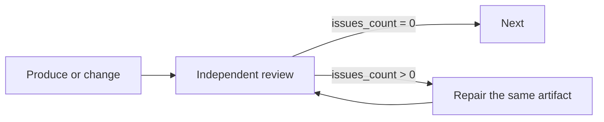

## Purpose

Use an independent reviewer when the workflow contract requires someone other than the producer to assess the artifact. Self-review remains useful, but it does not satisfy that independence requirement.

## Problem

A producer may overlook assumptions in its own work. A separate role provides another assessment, not a guarantee of objectivity or completeness. Judge the review by its reasoning and primary evidence.

## Solution

Use the host's available delegation mechanism, a child workflow, or another genuinely independent reviewing role. The reviewer must not have produced the artifact being judged.

1. Finish the artifact and freeze the version being reviewed.
2. Give the reviewer the requirements, artifact access, relevant primary context and report destination.
3. Let the reviewer inspect the actual sources and validation evidence.
4. Keep the artifact unchanged until that review returns.
5. Repair confirmed findings and return the revised artifact to the same gate.

## Review and Repair Contract



Keep the complete current findings in one canonical report. The reviewer overwrites that report for each reviewed version and returns only the field the route needs. Zero findings is valid. A count describes findings in the report; it does not prove that every source was read or that the artifact is correct.

The repair owner reads the report, reproduces each confirmed defect and fixes its cause. If a finding cannot be reproduced, or a real blocker prevents repair, report that cause instead of starting an unchanged iteration. The reviewer diagnoses; the producer repairs.

## Issue Contract

Use a flat list of actionable findings in the report. Do not make a severity label a reason to ignore a confirmed defect within the agreed scope. Keep observations or suggestions distinct from findings that block acceptance.

The following schema fragment belongs to the reviewing node. Detailed findings stay in the report, without a duplicate context array:

```json
{
  "type": "object",
  "properties": {
    "issues_count": {
      "type": "integer",
      "minimum": 0,
      "description": "Current actionable findings in the canonical review report"
    }
  },
  "required": ["issues_count"]
}
```

## Structure

```text
[do-work] → [delegate-review] → [check-result] → clean → [next]
                                     ↓
                                  repair → [fix-issues] → [delegate-review]
```

## Implementation

### Review Delegation Node

These node examples assume a declared, initialized global `workspace_path` and existing connection targets. No review verdict receives a default.

```json
{
  "type": "agent-directive",
  "id": "delegate-review",
  "directive": "Obtain independent review of the frozen artifact against the actual requirements. Give the reviewer direct access to the artifact, requirements and relevant primary sources. Save the complete current findings and reasoning in {{workspace_path}}/review.md. Do not change the artifact while review is in progress. Return the report's actual actionable finding count; do not copy its detailed contents into workflow variables.",
  "completionCondition": "Independent review of the unchanged artifact completed, report saved and current finding count reported honestly",
  "inputSchema": {
    "type": "object",
    "properties": {
      "issues_count": { "type": "integer", "minimum": 0 }
    },
    "required": ["issues_count"]
  },
  "connections": { "success": "check-review-result" }
}
```

### Key Directive Elements

State the reviewer's role, acceptance criteria, frozen artifact and report destination. Include enough dependency context to assess the change. Do not replace primary sources with the producer's assurances, conceal adverse evidence or frame the expected verdict as positive.

### Check Result Node

```json
{
  "type": "condition",
  "id": "check-review-result",
  "cases": [
    {
      "when": {
        "operator": "eq",
        "left": { "contextPath": "delegate-review.issues_count" },
        "right": 0
      },
      "output": "clean"
    }
  ],
  "connections": {
    "clean": "next-step",
    "default": "fix-issues"
  }
}
```

## Real Example

A plan gate reads the requirements and proposed plan, checks dependency order and whether each planned outcome is verifiable, then records the complete current findings at its canonical report address. A result gate reads the produced artifact and relevant evidence. They judge different artifacts and should not substitute for each other.

## Anti-Patterns

### Self-Review (Wrong)

Calling the producer's own assessment an independent review. Keep useful self-review, then obtain the separate assessment the contract requires.

### Biased Delegation (Wrong)

Ask the reviewer to judge the actual change rather than to confirm “the improvements.” Give actual evidence, including failures and limitations.

### Excessive Context (Wrong)

Copying unrelated conversation or duplicate reports obscures the primary artifact. Supply relevant source access and requirements without prescribing the verdict.

## Numeric Validation

Use the actual count of actionable findings when the graph routes on it. A reasoned verdict can serve the same purpose in another workflow. Neither a count nor a score substitutes for semantic review; JSON Schema validates the returned shape only.

## Best Practices

- Review one unchanged version and identify it unambiguously; use the caller's version/checksum convention when required.
- Give the reviewer direct access to the primary sources.
- Keep one canonical report and report confirmed gaps together.
- Preserve required independent review after repair; see [Repair Reach](/docs/patterns/repair-reach/).

## Related Patterns

- [Validation Loop](/docs/patterns/validation-loop/)
- [Step Verification](/docs/patterns/step-verification/)
- [Escalation](/docs/patterns/escalation/)
- [Anti-Patterns](/docs/patterns/anti-patterns/)
