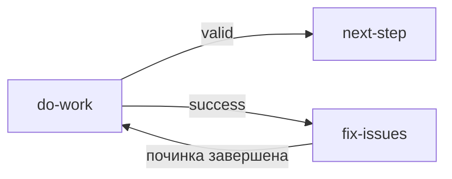
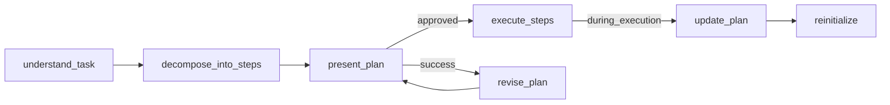
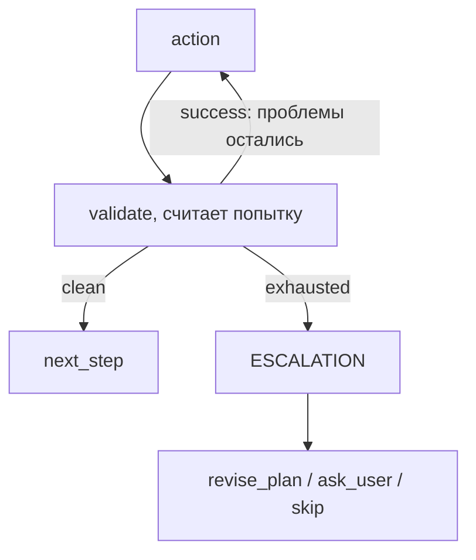
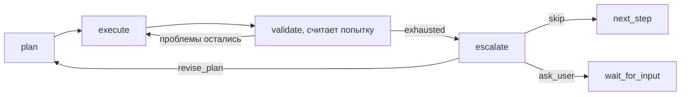

Это руководство охватывает создание workflow с нуля, включая типовые паттерны, циклы валидации и лучшие практики.

## Быстрый старт

1. Определите цель workflow и основные ответственности.
2. Спроектируйте граф и границы решений.
3. Создайте JSON с полными определениями нод.
4. Проверьте связи, объявления и нужные маршруты.
5. Сохраните через разрешённую операцию MCP.

## Структура Workflow

Каждый workflow должен содержать:

```jsonc
{
  "id": "my-workflow",
  "metadata": {
    "name": "Читаемое название",
    "version": "1.0.0",
    "description": "Что делает этот workflow",
  },
  "nodes": [
    // start узел (ровно один)
    // action узлы — узел, у которого есть свидетельство, несёт case, маршрутизирующие его
    // condition узлы — для решения, общего нескольким узлам, или решения, стоящего отдельно
    // end узел (минимум один)
  ],
}
```

## Типовые паттерны

### Цикл валидации

Используйте когда нужно проверить результат и повторить при ошибке. Узел, который произвёл
результат, сообщает, годится ли он, и маршрутизирует по этому ответу; владелец починки исправляет подтверждённые замечания перед следующей проверкой:



```json
[
  {
    "id": "do-work",
    "type": "agent-directive",
    "directive": "Выполни задачу",
    "completionCondition": "Задача выполнена",
    "inputSchema": {
      "type": "object",
      "properties": {
        "result_valid": { "type": "string", "enum": ["yes", "no"] }
      },
      "required": ["result_valid"]
    },
    "cases": [
      {
        "when": {
          "operator": "eq",
          "left": { "contextPath": "do-work.result_valid" },
          "right": "yes"
        },
        "output": "valid"
      }
    ],
    "connections": {
      "success": "fix-issues",
      "valid": "next-step"
    }
  },
  {
    "id": "fix-issues",
    "type": "agent-directive",
    "directive": "Исправь найденные проблемы",
    "completionCondition": "Все проблемы прошлой попытки исправлены",
    "connections": { "success": "do-work" }
  }
]
```

Это фрагменты нод содержащего workflow, а не полный граф. Целевые ноды должны существовать. Перед повтором установите и исправьте причину; независимое ревью остаётся отдельной ответственностью, когда его требует контракт. Счётчик нужен только реальному бюджету или потребителю артефактов, объявляется числовой записью реестра с default и изменяется через expressions.

### Ветвление по типу действия

Используйте когда workflow имеет разные пути для разных сценариев. Ветку выбирает тот самый ответ,
который шаг только что произвёл, поэтому case принадлежит самому шагу:

```json
{
  "id": "get-action",
  "type": "agent-directive",
  "directive": "Спроси пользователя: создать новый или редактировать существующий?",
  "completionCondition": "Пользователь назвал create или edit",
  "inputSchema": {
    "type": "object",
    "properties": {
      "action": { "type": "string", "enum": ["create", "edit"] }
    },
    "required": ["action"]
  },
  "cases": [
    {
      "when": {
        "operator": "eq",
        "left": { "contextPath": "get-action.action" },
        "right": "create"
      },
      "output": "create"
    }
  ],
  "connections": {
    "success": "edit-branch",
    "create": "create-branch"
  }
}
```

Case вычисляются по контексту, в который уже влит ответ ноды, поэтому ответ читается по простому
имени, если это объявленная глобальная переменная (`{{action}}`), и как `<node-id>.field`, если это
локальный выход ноды (`get-action.action`). `success` — запасной выход: прогон, ответ которого не
совпал ни с одним case, уходит в ветку редактирования.

**Решай на той ноде, у которой есть свидетельство.** Каждая лишняя нода — это переход, который
читателю приходится проследить, и ещё одно место, где решение расходится со свидетельством; граф,
который решает там, где знает, короче читается и не может маршрутизировать по устаревшей копии. То
же верно для одиночного арифметического шага: счётчик или производная сумма — это запись в
`expressions` уже работающей там ноды, а не отдельная нода.

Оставьте отдельную ноду `condition` или `expression`, когда так читается лучше: когда одно решение
общее для нескольких производителей, когда условие читает состояние, которого не произвела ни одна
отдельная нода, когда именованная точка решения помогает читателю вида процесса или когда вычисление
заслуживает собственного места в маршруте. В такой записи та же ветка — две ноды: у `get-action`
остаётся только `"connections": { "success": "route-action" }`, а решение переезжает в свою ноду.

```json
{
  "id": "route-action",
  "type": "condition",
  "cases": [
    {
      "when": {
        "operator": "eq",
        "left": { "contextPath": "get-action.action" },
        "right": "create"
      },
      "output": "create"
    }
  ],
  "connections": {
    "create": "create-branch",
    "default": "edit-branch"
  }
}
```

Нода `condition` или `expression`, единственная работа которой — маршрутизировать или считать то,
что предыдущая нода уже знает, — это избыточная маршрутизирующая обвязка; сложите её в ту ноду.

### Gate подтверждения

Используйте для критических действий требующих подтверждения. Ответ есть у того узла, который
спрашивает, поэтому он же по нему и маршрутизирует, а неподтверждённый прогон проваливается через
`success` в доработку:

```json
{
  "id": "show-plan",
  "type": "agent-directive",
  "directive": "Представь план пользователю и спроси подтверждение",
  "completionCondition": "Пользователь ответил yes или no",
  "inputSchema": {
    "type": "object",
    "properties": {
      "approved": { "type": "string", "enum": ["yes", "no"] },
      "feedback": { "type": "string" }
    },
    "required": ["approved"],
    "if": { "properties": { "approved": { "const": "no" } }, "required": ["approved"] },
    "then": {
      "required": ["feedback"],
      "properties": { "feedback": { "type": "string", "minLength": 1 } }
    }
  },
  "cases": [
    {
      "when": {
        "operator": "eq",
        "left": { "contextPath": "show-plan.approved" },
        "right": "yes"
      },
      "output": "approved"
    }
  ],
  "connections": {
    "success": "revise-plan",
    "approved": "proceed"
  }
}
```

## Паттерны Input Schema

### Ответ Да/Нет

```json
{
  "inputSchema": {
    "type": "object",
    "properties": {
      "result": { "type": "string", "enum": ["yes", "no"] },
      "details": { "type": "string" }
    },
    "required": ["result"]
  }
}
```

### Числовой счетчик

```json
{
  "inputSchema": {
    "type": "object",
    "properties": {
      "count": { "type": "number", "minimum": 0 },
      "total": { "type": "number", "minimum": 1 }
    },
    "required": ["count", "total"]
  }
}
```

### Массив элементов

```json
{
  "inputSchema": {
    "type": "object",
    "properties": {
      "items": {
        "type": "array",
        "items": { "type": "string" },
        "minItems": 1
      }
    },
    "required": ["items"]
  }
}
```

### Выбор из нескольких вариантов

```json
{
  "inputSchema": {
    "type": "object",
    "properties": {
      "action": {
        "type": "string",
        "enum": ["create", "edit", "delete", "cancel"]
      },
      "reason": { "type": "string" }
    },
    "required": ["action"]
  }
}
```

### Путь к файлу с паттерном

```json
{
  "inputSchema": {
    "type": "object",
    "properties": {
      "file_path": {
        "type": "string",
        "pattern": "^[a-zA-Z0-9/_.-]+\\.(json|yaml|yml)$"
      }
    },
    "required": ["file_path"]
  }
}
```

## Операторы условий

Каждый case узла condition связывает один из таких объектов условия с ключом соединения, который он
выбирает.

| Оператор   | Описание                      | Пример                         |
| ---------- | ----------------------------- | ------------------------------ |
| `eq`       | Равно                         | `"right": "value"`             |
| `neq`      | Не равно                      | `"right": "value"`             |
| `lt`       | Меньше                        | `"right": 10`                  |
| `gt`       | Больше                        | `"right": 0`                   |
| `lte`      | Меньше или равно              | `"right": 100`                 |
| `gte`      | Больше или равно              | `"right": 1`                   |
| `contains` | Вхождение в строку или массив | `"right": "urgent"`            |
| `and`      | Логическое И                  | `"conditions": [...]`          |
| `or`       | Логическое ИЛИ                | `"conditions": [...]`          |
| `not`      | Отрицание                     | `"condition": {...}`           |
| `exists`   | Переменная существует         | `"value": { "contextPath": …}` |

### Пример сложного условия

Фрагмент предполагает, что prepare-items возвращает локальные status и count; целевые ноды существуют в содержащем workflow.

```json
{
  "id": "check-ready",
  "type": "condition",
  "cases": [
    {
      "when": {
        "operator": "and",
        "conditions": [
          {
            "operator": "eq",
            "left": { "contextPath": "prepare-items.status" },
            "right": "ready"
          },
          {
            "operator": "gt",
            "left": { "contextPath": "prepare-items.count" },
            "right": 0
          }
        ]
      },
      "output": "ready"
    }
  ],
  "connections": {
    "ready": "process-items",
    "default": "wait"
  }
}
```

## Объявление знаний как глобальных переменных

Объявляйте переиспользуемые знания как глобальные переменные в `variableRegistry` workflow со значением `default`:

```json
{
  "variableRegistry": {
    "quality_rules": {
      "type": "string",
      "description": "Переиспользуемые правила качества, применяемые агентом на шагах",
      "default": "Правило 1: ... Правило 2: ..."
    },
    "validation_checklist": {
      "type": "string",
      "description": "Чеклист, который агент проверяет перед завершением шага",
      "default": "Проверка 1: ... Проверка 2: ..."
    }
  }
}
```

Обращение в директивах:

```json
{
  "directive": "Следуй этим правилам: {{quality_rules}}"
}
```

:::tip
Default реестра подходит стабильному тексту самого workflow. Применимые правила проекта читайте у их владельца; общие playbooks и материализованные справочники сохраняют свои контракты. Доставка текста не доказывает его соблюдение.
:::

## Чеклист валидации

Перед сохранением проверьте:

1. **Структура**
   - Ровно один start узел
   - Минимум один end узел
   - Все ID узлов уникальны
   - Все connections указывают на существующие узлы

2. **Достижимость**
   - Все обычные ноды достижимы от start; явные teleport-входы проверяются отдельно
   - Нет orphan узлов
   - Маршруты корректно заканчиваются либо переходят в предусмотренное ожидание, починку или эскалацию; нет слепого неизменённого повтора

3. **Определения узлов**
   - `directive` не пустой
   - `completionCondition` определен
   - `connections.success` указан — это выход, который директива берёт, когда не сработал ни один
     case
   - `inputSchema` — валидный JSON Schema
   - `cases` и `expressions` директивы подчиняются тем же правилам, что ниже: каждый case называет
     ключ соединения, отличный от `success`, `error` и `timeout`, а каждое выражение присваивает
     объявленную глобальную переменную

4. **Маршрутизация**
   - У ноды `condition` есть хотя бы один case и `connections.default`
   - Каждый case называет ключ из `connections` и никогда — `error` или `timeout`
   - Каждый авторский выход назван каким-нибудь case; выходу по умолчанию и управляющим выходам
     `error`/`timeout` case не нужен
   - Оператор валиден
   - Каждое выражение присваивает переменную, объявленную в `variableRegistry`

## Сохранение Workflows

### Создать новый

```typescript
mcp__moira__manage({
  action: "create",
  workflow: {
    id: "my-workflow",
    metadata: { name: "...", version: "1.0.0", description: "..." },
    nodes: [...]
  }
})
```

### Редактировать

```typescript
mcp__moira__manage({
  action: "edit",
  workflowId: "my-workflow",
  changes: {
    metadata: { version: "1.1.0" },
    updateNodes: [{ nodeId: "step-1", changes: { directive: "Новый текст" } }],
  },
});
```

### Загрузить файл

```typescript
// Для агентов с доступом к файловой системе
const { uploadUrl } = await mcp__moira__token({ action: "upload" });
// Загрузите JSON файл по uploadUrl
```

## Определение возможностей агента

Разные агенты имеют разные возможности. Проектируйте workflow для определения и адаптации:

### Категории возможностей

| Возможность      | Примеры                      | Метод определения           |
| ---------------- | ---------------------------- | --------------------------- |
| Файловая система | Read, Write, создание файлов | Спросить агента             |
| Web доступ       | Fetch URL, поиск             | Проверить наличие web tools |
| Только MCP       | Только инструменты Moira     | Предположение по умолчанию  |

### Паттерн определения

```json
{
  "id": "detect-capabilities",
  "completionCondition": "Current capabilities checked honestly within host access policy",
  "type": "agent-directive",
  "directive": "Сообщи свои возможности: есть ли доступ к файловой системе? можешь ли получать URL?",
  "inputSchema": {
    "type": "object",
    "properties": {
      "has_file_access": { "type": "boolean" },
      "has_web_access": { "type": "boolean" }
    },
    "required": ["has_file_access", "has_web_access"]
  },
  "connections": { "success": "route-by-capabilities" }
}
```

### Условное ветвление

Маршрутизация по возможностям — как раз случай отдельной ноды. К одному и тому же решению приходят
несколько шагов: каждая ветка, которой нужен файл или URL, задаёт один и тот же вопрос. Поэтому одна
именованная нода `route-by-capabilities` держит это решение в одном месте, вместо того чтобы
повторять один и тот же case на каждой приходящей туда ноде, а читатель вида процесса видит, где
поток расходится:

```json
{
  "id": "route-by-capabilities",
  "type": "condition",
  "cases": [
    {
      "when": {
        "operator": "eq",
        "left": { "contextPath": "detect-capabilities.has_file_access" },
        "right": true
      },
      "output": "file-access"
    }
  ],
  "connections": {
    "file-access": "file-based-flow",
    "default": "mcp-only-flow"
  }
}
```

:::tip
Предусматривайте только поддерживаемые fallback-маршруты. Доступность MCP зависит от настройки хоста и политики; если обязательная возможность недоступна, сообщите блокер.
:::

## Паттерн планирования

Используйте когда workflow должен создать и выполнить план с подтверждением пользователя и возможностью пересмотра.

### Проблема

Workflow часто требуют этапа планирования, но:

- Планы создаются один раз и не пересматриваются
- Требования к качеству плана не формализованы
- Нет возможности адаптировать план по ходу выполнения
- Агент теряет контекст в длинных сессиях

### Структура паттерна



### Ключевые компоненты

1. **variableRegistry.plan_writing_requirements** — правила написания планов (агент видит при создании)
2. **decompose_into_steps** — директива с `{{plan_writing_requirements}}` для создания плана
3. **user_approval_branch** — `present_plan` маршрутизирует по собранному им ответу: approved →
   execute, иначе revise_plan → present_plan
4. **update_during_execution** — возможность адаптировать план по ходу выполнения

### Требования к написанию плана

Главная проблема: агент теряет контекст (архивация сессии, простое забывание). Планы должны быть написаны так, чтобы любой шаг можно было выдать агенту БЕЗ остального плана — и он смог бы выполнить.

| Требование                      | Почему важно                                  | Пример                                                                     |
| ------------------------------- | --------------------------------------------- | -------------------------------------------------------------------------- |
| Плоский линейный список         | Легче отслеживать без иерархии                | 1, 2, 3... не 1.1, 1.2, 1.2.1                                              |
| Самодостаточные шаги            | Любой шаг выполним без контекста              | "Шаг 3: Создать файл X.ts с функцией Y" не "Продолжить работу"             |
| Явные действия                  | Не "как обычно", а конкретно                  | "Сделать коммит" в каждом шаге где нужен                                   |
| Измеримый результат             | Легко проверить выполнение                    | "expected_output: файл X.ts создан и содержит функцию Y"                   |
| Независимость                   | Минимум зависимостей между шагами             | Шаг 4 не должен требовать знания деталей шага 2                            |
| Полные пути к файлам            | Агент не должен угадывать                     | `/full/path/to/file.json`, не "в соответствующей папке"                    |
| Избыточность там, где применима | Повторяйте то, что пункту действительно нужно | «Сделать коммит» — в пункте, который коммитом заканчивается, а не в каждом |

### Атомарность пункта

Каждый пункт плана или задачи должен быть самодостаточным. Агент часто получает директиву ОДНОГО пункта изолированно — без остального плана — поэтому пункт должен нести всё необходимое для его выполнения:

- Повторить нюансы, от которых зависит пункт.
- Повторить релевантное исходное требование внутри пункта.
- Повторить сквозное действие (отчёт о прогрессе, запуск тестов, коммит) в тех пунктах, которым оно действительно нужно.

Не полагайтесь на память исполнителя о других пунктах, поэтому пункт, опирающийся на «как выше», невыполним. Ответ — то, что нужно исполнителю в одиночестве, и решается это по каждому пункту, а не безусловным дублированием: повторённый текст становится вторым источником правды и расходится, а пункт, обязанный нести всё, разрастается, пока не начинает нести сам результат. См. [Обязательная избыточность каждого пункта плана](/ru/docs/patterns/anti-patterns/).

```json
{
  "id": "execute-plan-item",
  "type": "agent-directive",
  "directive": "Execute one plan item.\n\nThe item text is self-contained: it states the original requirement, the files to read/modify with full paths, and the cross-cutting actions (run tests, make commit) that apply to THIS item.\n\nDo NOT assume any context from other items.",
  "completionCondition": "Item executed, tests run, and commit made as stated in the item",
  "connections": { "success": "next-item" }
}
```

:::tip
Два связанных паттерна развивают это руководство: [паттерн Replan](/ru/docs/patterns/replan/)
пересматривает многошаговый план по ходу выполнения, а [паттерн Completeness
Self-Review](/ru/docs/patterns/self-review/) проверяет каждое требование против реального
артефакта перед выдачей.
:::

### Пример реализации

Полный workflow ниже охватывает только подготовку и одобрение плана. Исполнение и независимое ревью добавляются как отдельные предметные ответственности, когда их требует контракт задачи. Один владелец пересматривает канонический план по замечаниям. Пример не разрешает развёртывание или операции VCS.

```json
{
  "id": "c4786f09-0769-4437-84b7-b032eab5396f",
  "metadata": {
    "name": "Draft and approve a plan",
    "version": "1.0.0",
    "description": "Prepare a scoped plan and obtain the user's actual approval"
  },
  "variableRegistry": {
    "plan": { "type": "string", "description": "Current canonical plan" }
  },
  "nodes": [
    { "id": "start", "type": "start", "connections": { "default": "prepare-plan" } },
    {
      "id": "prepare-plan",
      "type": "agent-directive",
      "directive": "Read the actual requirements and applicable project instructions. Prepare a plan of verifiable outcomes with dependency order, source owners, relevant validation and authority limits. {{#if present-plan.user_feedback}}Revise the plan against the user's feedback: {{present-plan.user_feedback}}{{/if}}",
      "completionCondition": "The current plan covers the requirements without claiming unperformed work or unauthorized effects",
      "inputSchema": {
        "type": "object",
        "globalInputs": ["plan"],
        "properties": {},
        "required": ["plan"]
      },
      "connections": { "success": "present-plan" }
    },
    {
      "id": "present-plan",
      "type": "agent-directive",
      "directive": "Present {{plan}} and wait for the user's actual answer. Record plan_approved=yes only for explicit approval of this version. Otherwise record no and the user's feedback; do not repair the plan at this gate.",
      "completionCondition": "The user has actually approved this plan or supplied the feedback recorded for revision",
      "inputSchema": {
        "type": "object",
        "properties": {
          "plan_approved": { "type": "string", "enum": ["yes", "no"] },
          "user_feedback": { "type": "string" }
        },
        "required": ["plan_approved"],
        "if": {
          "properties": { "plan_approved": { "const": "no" } },
          "required": ["plan_approved"]
        },
        "then": {
          "required": ["user_feedback"],
          "properties": { "user_feedback": { "type": "string", "minLength": 1 } }
        }
      },
      "cases": [
        {
          "when": {
            "operator": "eq",
            "left": { "contextPath": "present-plan.plan_approved" },
            "right": "yes"
          },
          "output": "approved"
        }
      ],
      "connections": { "success": "prepare-plan", "approved": "end" }
    },
    { "id": "end", "type": "end", "connections": {} }
  ]
}
```

### Показ плана как прогресса

План или чеклист, лежащий в переменных, не виден тому, кто наблюдает за прогоном, пока виду процесса
не сказано, где он лежит. Привяжите список к блоку, шаги которого его проходят: `list` называет пути
до массива (`items`), заголовка внутри одного элемента (`title`), индекса текущего элемента
(`current`, отсчитываемого от `indexBase`), числа завершённых (`done`) и общего числа (`total`) — и
прогон начинает показывать done/total и элемент, над которым идёт работа.

```json
{
  "id": "execute",
  "label": "Execute",
  "content": { "summary": "Проходим утверждённый план по одному пункту" },
  "list": {
    "items": "decompose-into-steps.steps",
    "title": "action",
    "current": "current_step_index",
    "total": "total_steps"
  }
}
```

Обязателен хотя бы один из `items`, `current` и `total`; `total` по умолчанию равен длине `items`, а
`done` — `current − indexBase`. Полный справочник полей — в разделе
[Workflows](/ru/docs/concepts/workflows/).

### Обновление плана по ходу выполнения

Используйте [Пересмотр процесса](/ru/docs/patterns/process-revision/) и [Replan](/ru/docs/patterns/replan/): один разрешённый teleport ведёт к существующему владельцу пересмотра, а новая редакция проходит обычное ревью и необходимое одобрение. Сохраните позиции завершённых пунктов и их свидетельства; выведите зависимые итоги из реального плана, не обнуляя прогресс отдельным ручным шагом.

## Паттерн эскалации

Используйте когда workflow имеет циклы валидации которые могут застрять. Предоставляет механизм выхода после повторных неудач.

### Проблема

Когда агент застревает в цикле валидации:

- Бесконечные повторы без прогресса
- Одни и те же ошибки повторяются
- Нет способа выйти из цикла
- Пользователь ждёт бесконечно

### Структура паттерна



### Когда применять

- Workflows с планированием (robust-task, development)
- Workflows с валидацией результатов (workflow-management, test-generation)
- Любые циклы "сделай → проверь → повтори"

### Варианты эскалации

| Вариант       | Когда использовать     | Пример                                   |
| ------------- | ---------------------- | ---------------------------------------- |
| `revise_plan` | Текущий план неверен   | Тесты падают из-за неправильного дизайна |
| `ask_user`    | Нужно решение человека | Неясные требования                       |
| `skip`        | Шаг не критичен        | Опциональное улучшение                   |

### Пример реализации

Следующий пример иллюстрирует явно выбранный бюджет: содержащий workflow объявляет step_retry числовой записью реестра с description и default: 0. Бюджет не универсален. Чистый результат проверяется до исчерпания бюджета; самостоятельный блокер требует эскалации, а не слепого повтора. Всё решение принадлежит шагу, который проверяет результат: он считает попытку в `expressions`, а его
case отправляют чистый результат дальше, исчерпанный бюджет — на эскалацию, а всё остальное через
`success` — на новую попытку.

```json
[
  {
    "id": "validate-step",
    "type": "agent-directive",
    "directive": "ТОЛЬКО ПРОВЕРЬ результат шага. Подсчитай найденные проблемы. Попытка {{step_retry}}.",
    "completionCondition": "Количество проблем сообщено",
    "inputSchema": {
      "type": "object",
      "properties": {
        "issues_count": { "type": "number", "minimum": 0 }
      },
      "required": ["issues_count"]
    },
    "expressions": ["step_retry = step_retry + 1"],
    "cases": [
      {
        "when": {
          "operator": "eq",
          "left": { "contextPath": "validate-step.issues_count" },
          "right": 0
        },
        "output": "clean"
      },
      {
        "when": { "operator": "gte", "left": { "contextPath": "step_retry" }, "right": 3 },
        "output": "exhausted"
      }
    ],
    "connections": {
      "success": "retry-action",
      "clean": "next-step",
      "exhausted": "notify-escalation"
    }
  },
  {
    "id": "notify-escalation",
    "type": "user-notification",
    "message": "⚠️ *Шаг снова не проходит проверку*\n\nВыберите: вернуться и пересмотреть план, попросить человека помочь с конкретной проблемой или пропустить шаг, если он необязателен.",
    "format": "markdown",
    "connections": { "default": "ask-escalation-decision", "error": "ask-escalation-decision" }
  },
  {
    "id": "ask-escalation-decision",
    "type": "agent-directive",
    "directive": "Шаг не удался после {{step_retry}} попыток.\n\nСпроси пользователя:\n1. **revise_plan** — вернуться к планированию и пересмотреть подход\n2. **ask_user** — запросить помощь человека с конкретной проблемой\n3. **skip** — пропустить этот шаг и продолжить\n\n`decision` записывает собственный выбор пользователя: каждый из трёх вариантов ведёт в своё место, поэтому предположенный ответ выбирает маршрут за него.",
    "completionCondition": "Пользователь выбрал один из трёх вариантов",
    "inputSchema": {
      "type": "object",
      "properties": {
        "escalation_decision": {
          "type": "string",
          "enum": ["revise_plan", "ask_user", "skip"]
        },
        "user_input": { "type": "string" }
      },
      "required": ["escalation_decision"],
      "if": {
        "properties": { "escalation_decision": { "const": "ask_user" } },
        "required": ["escalation_decision"]
      },
      "then": {
        "required": ["user_input"],
        "properties": { "user_input": { "type": "string", "minLength": 1 } }
      }
    },
    "cases": [
      {
        "when": {
          "operator": "eq",
          "left": { "contextPath": "ask-escalation-decision.escalation_decision" },
          "right": "revise_plan"
        },
        "output": "revise"
      },
      {
        "when": {
          "operator": "eq",
          "left": { "contextPath": "ask-escalation-decision.escalation_decision" },
          "right": "skip"
        },
        "output": "skip"
      }
    ],
    "connections": {
      "success": "handle-user-help",
      "revise": "revise-plan",
      "skip": "mark-step-skipped"
    }
  }
]
```

Три исхода тоже не требуют отдельного узла: два case называют ветки, уходящие с обычного пути, а
третий несёт `success`. Enum гарантирует, что четвёртого не будет.

### Комбинация с паттерном планирования

При использовании обоих паттернов — Planning и Escalation:



Вариант `revise_plan` возвращает к фазе Planning, позволяя агенту пересмотреть подход на основе того, что он узнал из неудач.

:::tip
Выбирайте бюджет только по действующей политике, а не произвольной оценке сложности. Skip разрешён только явно необязательному условию; он не обходит обязательное ревью, согласование или полномочия на внешний эффект.
:::

## Production паттерны

Примеры ниже показывают отдельные решения; выбирайте их по реальным потребителям и действующим полномочиям.

### Express/Full Mode ветвление

Маршрутизация в упрощённый или полный flow в зависимости от сложности. Режим устанавливает тот шаг,
который по нему и маршрутизирует:

```
[get-requirements] → express → [express-flow]
                   → success → [full-flow]
```

```json
{
  "id": "get-requirements",
  "type": "agent-directive",
  "directive": "Собери требования и реши, подходит ли задаче режим express.",
  "completionCondition": "Требования собраны, режим выбран",
  "inputSchema": {
    "type": "object",
    "properties": {
      "development_mode": { "type": "string", "enum": ["express", "full"] }
    },
    "required": ["development_mode"]
  },
  "cases": [
    {
      "when": {
        "operator": "eq",
        "left": { "contextPath": "get-requirements.development_mode" },
        "right": "express"
      },
      "output": "express"
    }
  ],
  "connections": {
    "success": "analyze-and-plan",
    "express": "express-implementation"
  }
}
```

### Цикл уточнения плана

Представить план → получить фидбек → уточнить → подтвердить:

```
[present-plan] → approved → [continue]
               → success  → [refine] → [confirm] → [continue]
```

### Паттерн числовой валидации (рекомендуемый)

Число замечаний уместно, когда маршрут действительно зависит от числа подтверждённых дефектов. Рецензент изучает реальный артефакт по требованиям и объясняет находки в одном каноническом отчёте. Число можно исказить так же, как boolean: движок проверяет форму ответа и вычисляет маршрут, а не истинность ревью.

```json
{
  "id": "validate-result",
  "type": "agent-directive",
  "directive": "Inspect the real artifact against its requirements. Write the complete current findings and reasoning to the agreed report, then return its actual actionable finding count. Do not repair at this independent gate.",
  "completionCondition": "Required independent review completed on an unchanged artifact and current findings recorded honestly",
  "inputSchema": {
    "type": "object",
    "properties": {
      "issues_count": { "type": "integer", "minimum": 0 }
    },
    "required": ["issues_count"]
  },
  "cases": [
    {
      "when": {
        "operator": "eq",
        "left": { "contextPath": "validate-result.issues_count" },
        "right": 0
      },
      "output": "clean"
    }
  ],
  "connections": { "success": "fix-issues", "clean": "next-step" }
}
```

Это фрагмент ноды: адрес отчёта и названные целевые ноды задаются содержащим workflow. Другому процессу лучше подойдёт обоснованный вердикт pass/repair. Не заменяйте смысловую оценку произвольным баллом и не требуйте чисел без потребителя.

### Числовая валидация с результатами тестов

Числа берите только из реального запуска выбранных тестов, когда они нужны читателю отчёта. Ноль упавших тестов не доказывает выполнение нужных проверок: пустая выборка, пропуски, отказ инфраструктуры и неуспешный процесс тоже могут дать ноль. Изучите фактический исход runner и охват выбранных проверок перед маршрутом успеха; сохраняйте сбои и блокеры в свидетельствах.

### Уведомления пользователя

Уведомления держат пользователя в курсе во время долгих workflows. Используйте их стратегически — слишком много уведомлений становятся шумом.

#### Когда использовать уведомления

| Сценарий                        | Зачем уведомлять                                           |
| ------------------------------- | ---------------------------------------------------------- |
| **План готов**                  | Пользователь видит, что будет сделано, и может согласовать |
| **Требуется ввод пользователя** | Пользователь знает что нужно ответить                      |
| **Критические ошибки**          | Немедленное информирование о блокерах                      |
| **Завершение задачи**           | Пользователь может проверить результаты                    |

#### Когда НЕ использовать

- Короткие workflows (< 5 минут)
- Между каждым мелким шагом
- Для внутренних validation loops
- Когда ошибка авто-восстанавливаема

#### Что говорит сообщение

Уведомление — всё, что человек видит от прогона, часто на телефоне. Движок уже открывает каждое
сообщение названием флоу и задачей прогона со ссылкой на страницу прогона, поэтому сообщение их не
повторяет. Первый шаг, устанавливающий фактическую задачу, сохраняет её через защищённую операцию
[именования запуска](/ru/docs/concepts/workflows/#название-задачи-запуска). Ответственный за
разрешённое изменение задачи обновляет то же название; произвольная `execution_note` остаётся отдельно.

- Список плана берётся из списка, привязанного к рабочему блоку (см. справочник по прогрессу),
  через `planList`: `full` при готовности плана и на каждом завершении, `progress` — строка
  `📝 сделано/всего: текущий пункт` — в остальных местах. Не пишите список в сообщение.
- Никакое внутреннее значение не доходит до читателя: ни путь или имя файла, ни синтаксис
  шаблонов, ни id ноды, ни имя переменной, ни сырое значение перечисления, ни счётчик без названия.
  Строка из значений прогона берётся из поля в одно предложение, которое шаг пишет для человека
  (выход `…_summary`, о котором это говорит его директива); значение перечисления передаётся
  словами — веткой шаблона или отдельным сообщением на каждый исход.
- Место уведомления следует режиму работы. Интерактивный запуск узнаёт о вопросе до него, с
  объяснёнными вариантами. Автономному запуску никогда не говорят, что решение ждёт: при готовности
  плана он узнаёт, что работа идёт, а после решения, принятого агентом, получает одно сообщение —
  что решено и почему, — отправленное с собственного маршрута решающей ноды.
- Последнее сообщение прогона соединено прямо с `end`, поэтому в его списке ни один пункт не
  отмечен как идущий.

Workflow Management Flow проверяет по этим правилам каждое уведомление в workflow, который создаёт.

#### Паттерн: План готов

Объявите план, когда он готов, со всем списком. Интерактивный запуск просит согласования,
автономный идёт дальше:

```json
[
  {
    "id": "notify-plan-approval",
    "type": "user-notification",
    "message": "📋 *План ждёт вашего согласования* — согласуйте, и работа пойдёт дальше, или отклоните с фидбеком, и план исправят.",
    "format": "markdown",
    "planList": "full",
    "connections": { "default": "present-plan-to-user" }
  },
  {
    "id": "notify-work-started",
    "type": "user-notification",
    "message": "▶️ *План готов — работа продолжается в согласованном объёме.*",
    "format": "markdown",
    "planList": "full",
    "connections": { "default": "execute-step" }
  }
]
```

Первое ставится на интерактивную ветку маршрута по режиму, второе — на автономную.

#### Паттерн: Нужно ваше решение

Когда автоматические повторы не помогли и решать должен человек, скажите, какой шаг, почему и что
даёт каждый вариант:

```json
{
  "id": "notify-escalation",
  "type": "user-notification",
  "message": "⚠️ *Шагу нужно ваше решение* — шаг «{{current_step_title}}» не проходит проверку: {{review-step.failure_summary}}\n\nВыберите: попробовать ещё раз, изменить план или завершить, оставив шаг невыполненным.",
  "format": "markdown",
  "connections": { "default": "ask-user-decision" }
}
```

`failure_summary` — поле в одно предложение, которое проверяющий шаг возвращает, когда проверка не
пройдена. В автономном запуске решает агент; решающая нода направляет каждый исход к своему
сообщению, отправленному после решения:

```json
{
  "id": "notify-retry-decided",
  "type": "user-notification",
  "message": "🔁 *Решено за вас* — пробуем шаг ещё раз. {{ask-user-decision.decision_summary}}",
  "format": "markdown",
  "connections": { "default": "retry-step" }
}
```

#### Паттерн: Завершение

Скажите словами, чем закончился прогон, и покажите итоговое состояние плана:

```json
{
  "id": "notify-completion",
  "type": "user-notification",
  "message": "🏁 *{{#eq delivery_status 'complete'}}Готово{{else}}Готово, есть открытые пункты{{/eq}}* — {{deliver-result.result_summary}}",
  "format": "markdown",
  "planList": "full",
  "connections": { "default": "end" }
}
```

:::tip
Укажите для `connections.error` ту же цель, что и для `default`, если сбой уведомления не должен
блокировать workflow. Без error connection полный сбой уже продолжает выполнение через `default`
с явным результатом `all_failed`.
:::

:::note
Для очень долгих задач (часы) рассмотрите периодические heartbeat уведомления "всё ещё работаю",
чтобы пользователь знал что процесс жив.
:::

## Паттерны файловой персистенции

Файл даёт большому или общему артефакту канонический адрес. Переменные и история выполнения уже сохраняются движком; файл не нужен только из-за возможного прерывания разговора. Используйте назначенный проектом игнорируемый workspace и соблюдайте полномочия на файловую систему и раскрытие данных.

### Структура директорий

Например, после объявления и инициализации глобального `workspace_path` владельцем workspace:

```text
{{workspace_path}}/
├── process-id.txt
├── plan.md
├── steps/
│   └── result.md
└── final-report.md
```

Владение, локальное игнорирование и materialize описаны в [Workspace](/ru/docs/patterns/workspace/). Это пример путей, а не команда создать директорию в корне проекта.

### Отслеживание прогресса

Содержательный владелец workspace записывает ID выполнения вместе с handoff-артефактами либо доставляет стабильные файлы из реестра через `materialize`. Не добавляйте ход только для копирования ID. Найденный handoff не разрешает возобновлять отменённое или чужое выполнение: сначала изучите текущее состояние соответствующего запуска.

### Снимки итераций

Отдельные снимки нужны, когда реальному рецензенту или восстановлению требуются неизменяемые версии. Если имя использует номер итерации, объявите и инициализируйте числовую запись реестра, а увеличение выполняйте у существующего владельца expressions. Не добавляйте счётчики и снимки без потребителя. Не меняйте проверяемые байты до получения ревью.

### Выгрузка контекста

Подробный артефакт хранится в одном каноническом файле, потребители получают путь. Производитель `produce-analysis` может вернуть локальный `file_path`; последующий полный фрагмент ноды читает его:

```json
{
  "id": "analyze-with-file-reference",
  "type": "agent-directive",
  "directive": "Read the relevant analysis at {{produce-analysis.file_path}} and complete the requested assessment against the actual requirements.",
  "completionCondition": "Analysis applied and substantive assessment completed with limitations reported",
  "connections": { "success": "next-step" }
}
```

### Когда использовать файловую персистенцию

Используйте файлы для навигации по отчётам, больших тел и передачи независимым читателям. Сохранённые переменные workflow подходят небольшим решениям и данным с прямыми потребителями. Предусмотрите поддерживаемый context-only маршрут, если файлы необязательны; если обязательный файловый контракт невыполним, сообщите блокер вместо выдуманного результата.

## Проблема получения ответа от пользователя

Схема проверяет форму отправленного ответа, но не устанавливает, что его дал человек. Если workflow требует настоящего решения пользователя, агент должен дождаться этого решения.

### Проблема

Показать план и сразу отправить `approved: "yes"` означает придумать одобрение. Имя поля, обязательная строка evidence и аннотация humanGate не делают предполагаемый ответ законным.

### Решение: скажите, чем является ответ

Поле записывает ответ пользователя о текущем артефакте. Это фрагмент ноды; названные цели должны существовать в содержащем workflow:

```json
{
  "id": "approve-plan",
  "type": "agent-directive",
  "directive": "Present the current plan and wait for the user's actual answer. approved records that answer: without one there is nothing to submit. Record user_response_text verbatim. Rejection feedback belongs to the revision owner, not to an unreviewed repair at this gate.",
  "completionCondition": "The user actually responded about this version and the answer is recorded without assumption",
  "inputSchema": {
    "type": "object",
    "properties": {
      "approved": { "type": "string", "enum": ["yes", "no"] },
      "user_response_text": { "type": "string", "minLength": 1 }
    },
    "required": ["approved", "user_response_text"]
  },
  "cases": [
    {
      "when": {
        "operator": "eq",
        "left": { "contextPath": "approve-plan.approved" },
        "right": "yes"
      },
      "output": "approved"
    }
  ],
  "connections": { "success": "revise-plan", "approved": "proceed" }
}
```

### Ключевые техники

- Укажите владельца решения, редакцию артефакта и последствия каждого ответа.
- Дождитесь ответа поддерживаемым механизмом хоста; показ вопроса не означает получение ответа.
- Сохраните настоящие замечания для владельца пересмотра и повторите обязательное ревью.
- Одобрение плана само по себе не разрешает публикацию, развёртывание и другие внешние эффекты, если контракт вызывающей стороны не предоставляет эти полномочия явно.

### Разделение на две ноды (альтернатива)

Отдельная ответственность представления полезна только при самостоятельном артефакте или границе решения. Простое разделение показа и записи ответа не предотвращает вымышленного одобрения и добавляет ходы:

```text
[подготовить содержательный артефакт] → [получить настоящий ответ] → одобрение / пересмотр
```

При проверке взаимодействия наблюдайте реальное ожидание, настоящий ответ, замечания при отказе и выбранный маршрут. Разбор JSON не проверяет участие человека.

## Лучшие практики

1. **Один узел = одна ответственность** — отделяйте обязательное независимое ревью от починки; производитель может запускать собственные точечные проверки
2. **Решайте там, где свидетельство** — узел, который произвёл ответ, несёт `cases`,
   маршрутизирующие по нему; отдельный `condition` — для общего или именованного решения
3. **Ясные директивы** — начинайте с глагола: Создай, Проверь, Исправь
4. **Явные отрицания** — "НЕ исправляй, ТОЛЬКО проверь"
5. **Используйте inputSchema** — задавайте данные, нужные реальному потребителю
6. **Обоснованная проверка** — выбирайте наблюдения и вердикт по проверяемому свойству
7. **Повторы по причине** — нужен диагноз, изменённая работа или действующий бюджет; счётчик сам по себе не останавливает цикл
8. **Gate подтверждения** — для критических действий
9. **Самодокументирование** — объявляйте знания как значения по умолчанию в variableRegistry
10. **Graceful уведомления** — ошибки каналов связи не должны блокировать workflow

## Связанное

- [Узлы](/ru/docs/concepts/nodes/) — Справочник типов узлов
- [Шаблоны](/ru/docs/concepts/templates/) — Динамический контент
- [Инструменты](/ru/docs/reference/tools/) — Справочник MCP tools
- [Паттерн Replan](/ru/docs/patterns/replan/) — Пересмотр многошагового плана по ходу выполнения
- [Completeness Self-Review](/ru/docs/patterns/self-review/) — Проверка каждого требования перед выдачей
