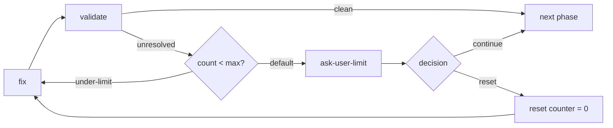

## Назначение

Когда автоматические повторные попытки не дают результата, эскалация пользователю для ручного вмешательства. Предотвращает бесконечные циклы и позволяет использовать человеческое суждение при сложных сбоях.

Примеры ниже — фрагменты, целевые ноды которых должны существовать в содержащем workflow. `current_iteration`, `validation_round` и `max_validation_rounds` нужны только действующей политике повторов; объявите их числовыми записями реестра с начальными default, как в паттерне цикла валидации. Выходы ошибок принадлежат `handle-error`, решение пользователя — ноде, получившей настоящий ответ.

`continue` и `skip` допустимы только для явно необязательного или допускающего отказ условия. Они не обходят обязательное ревью, согласование, доступ или границу внешнего эффекта. При таком блокере сохраняйте работу и эскалируйте. Сброс счётчика не разрешает повтор внешнего действия с неизвестным исходом.

## Эскалация при достижении лимита ограниченного цикла

Когда ограниченный цикл ([цикл валидации](/ru/docs/patterns/validation-loop/) или цикл исправления/повтора) достигает лимита итераций, ветвь лимита направляет к узлу запроса у пользователя. Она никогда не пропускает молча к следующей фазе — это скрывает неустранённые проблемы от пользователя.

Узел запроса у пользователя предлагает два решения:

- **continue** — принять текущий результат и продолжить, несмотря на оставшиеся проблемы
- **reset** — обнулить счётчик через узел expression и вернуться к шагу исправления



Решение фиксируется enum из двух вариантов:

```json
{
  "type": "agent-directive",
  "id": "ask-user-limit",
  "directive": "Validation reached its limit of {{max_validation_rounds}} rounds with {{validate-result.issues_count}} issues remaining.\n\nAsk the user how to proceed:\n- continue: accept the current result and move on\n- reset: keep fixing (the round counter resets to 0)",
  "completionCondition": "User chose continue or reset",
  "inputSchema": {
    "type": "object",
    "properties": {
      "decision": { "type": "string", "enum": ["continue", "reset"] }
    },
    "required": ["decision"]
  },
  "connections": { "success": "route-limit-decision" }
}
```

Маршрутизация решения: `continue` переходит к следующей фазе, `reset` запускает узел expression сброса счётчика и возвращается обратно.

```json
{
  "type": "condition",
  "id": "route-limit-decision",
  "cases": [
    {
      "when": {
        "operator": "eq",
        "left": { "contextPath": "ask-user-limit.decision" },
        "right": "reset"
      },
      "output": "reset"
    }
  ],
  "connections": {
    "reset": "reset-validation-counter",
    "default": "next-phase"
  }
}
```

```json
{
  "type": "expression",
  "id": "reset-validation-counter",
  "expressions": ["validation_round = 0"],
  "connections": { "default": "fix-step" }
}
```

:::caution
Направление ветви лимита прямо к следующей фазе — это антипаттерн молчаливого пропуска. Всегда
направляйте её через узел запроса у пользователя, чтобы пользователь сохранял контроль над
неустранёнными проблемами.
:::

## Структура

```
[action] → [verify] → failure → [check-retries] → retries<max → [retry]
                                               → retries>=max → [escalate-to-user]
```

## Реализация

### Проверка лимита повторов

```json
{
  "type": "condition",
  "id": "check-retry-limit",
  "cases": [
    {
      "when": {
        "operator": "lt",
        "left": { "contextPath": "current_iteration" },
        "right": 3
      },
      "output": "under-limit"
    }
  ],
  "connections": {
    "under-limit": "fix-and-retry",
    "default": "escalate-to-user"
  }
}
```

### Узел эскалации

```json
{
  "type": "agent-directive",
  "id": "escalate-to-user",
  "completionCondition": "Actual user decision and any required repair instructions recorded without waiving mandatory authority or review",
  "directive": "Automated resolution failed after {{current_iteration}} attempts.\n\nProblem: {{handle-error.last_error}}\nAttempted fixes: {{handle-error.attempted_fix}}\n\nAsk user how to proceed:\n- Continue with current result as-is?\n- Reset counter and try fixing again?\n- Provide manual fix instructions?\n- Skip this step?\n- Abort workflow?",
  "inputSchema": {
    "type": "object",
    "properties": {
      "user_decision": { "type": "string", "enum": ["continue", "reset", "fix", "skip", "abort"] },
      "user_instructions": { "type": "string" }
    },
    "required": ["user_decision"],
    "if": { "properties": { "user_decision": { "const": "fix" } }, "required": ["user_decision"] },
    "then": {
      "required": ["user_instructions"],
      "properties": { "user_instructions": { "type": "string", "minLength": 1 } }
    }
  },
  "connections": { "success": "route-user-decision" }
}
```

:::tip
Всегда предоставляйте контекст пользователю: что не удалось, сколько попыток было, что пробовали.
Это помогает ему принять обоснованное решение.
:::

### Маршрутизация решения пользователя

Один узел condition обслуживает все решения, допускаемые enum: каждый case называет output для
одного ответа, а оставшийся ответ (`fix`) уходит в `default`. Два ответа могут делить один output,
как здесь `continue` и `skip`.

```json
{
  "type": "condition",
  "id": "route-user-decision",
  "cases": [
    {
      "when": {
        "operator": "eq",
        "left": { "contextPath": "escalate-to-user.user_decision" },
        "right": "reset"
      },
      "output": "reset"
    },
    {
      "when": {
        "operator": "eq",
        "left": { "contextPath": "escalate-to-user.user_decision" },
        "right": "continue"
      },
      "output": "proceed"
    },
    {
      "when": {
        "operator": "eq",
        "left": { "contextPath": "escalate-to-user.user_decision" },
        "right": "skip"
      },
      "output": "proceed"
    },
    {
      "when": {
        "operator": "eq",
        "left": { "contextPath": "escalate-to-user.user_decision" },
        "right": "abort"
      },
      "output": "abort"
    }
  ],
  "connections": {
    "reset": "reset-counter",
    "proceed": "proceed-to-next",
    "abort": "workflow-aborted",
    "default": "apply-user-fix"
  }
}
```

```json
{
  "type": "expression",
  "id": "reset-counter",
  "expressions": ["current_iteration = 0"],
  "connections": { "default": "fix-and-retry" }
}
```

## Сбор контекста ошибок

Отслеживание ошибок во время повторных попыток:

```json
{
  "id": "handle-error",
  "type": "agent-directive",
  "completionCondition": "Observed failure and attempted repair recorded for the escalation consumer",
  "connections": { "success": "escalate-to-user" },
  "directive": "Record error details for escalation context.\n\nCurrent iteration: {{current_iteration}}\nError encountered: [describe error]",
  "inputSchema": {
    "properties": {
      "last_error": { "type": "string" },
      "attempted_fix": { "type": "string" }
    },
    "required": ["last_error", "attempted_fix"]
  }
}
```

## Корректное прерывание

```json
{
  "type": "agent-directive",
  "id": "workflow-aborted",
  "completionCondition": "Owned partial results and unresolved work recorded; only authorized cleanup performed",
  "directive": "User chose to abort workflow.\n\nCleanup tasks:\n- Save partial progress\n- Document what was completed\n- Note why abort was necessary",
  "inputSchema": {
    "properties": {
      "cleanup_completed": { "type": "boolean" },
      "progress_summary": { "type": "string" }
    },
    "required": ["cleanup_completed"]
  },
  "connections": { "success": "end-aborted" }
}
```

Завершение авторского маршрута через `end` даёт обычный завершённый запуск с описанным частичным результатом; оно не переводит выполнение в статус `stopped`. Для фактической остановки используйте разрешённое действие `execution` (`stop-execution`) и его требования, не отвечая фиктивным успехом.

## Уровни эскалации

Для сложных workflow рассмотрите несколько уровней эскалации:

1. **Автоматический повтор**: Первые 3 попытки
2. **Анализ агентом**: Более глубокое исследование
3. **Уведомление пользователя**: Информировать, но продолжить
4. **Вмешательство пользователя**: Требуется решение
5. **Полное прерывание**: Остановить workflow

## Реальный пример

Пример ответственности за получение настоящего ответа пользователя; его решение должен читать соответствующий маршрут содержащего workflow:

```json
{
  "id": "collect-user-feedback",
  "type": "agent-directive",
  "completionCondition": "Actual user decision and relevant guidance recorded",
  "connections": { "success": "route-feedback" },
  "directive": "Verification failed {{current_iteration}} times.\n\nAsk user:\n- Provide guidance for resolution?\n- Skip this step?\n- Modify the plan?\n\nSummarize the problem and what has been attempted.",
  "inputSchema": {
    "properties": {
      "user_guidance": { "type": "string" },
      "decision": { "type": "string", "enum": ["continue", "skip", "modify"] }
    },
    "required": ["decision"]
  }
}
```

## Связанные паттерны

- [Цикл валидации](/ru/docs/patterns/validation-loop/) - Автоматический повтор перед эскалацией
- [Верификация шагов](/ru/docs/patterns/step-verification/) - Что запускает эскалацию
