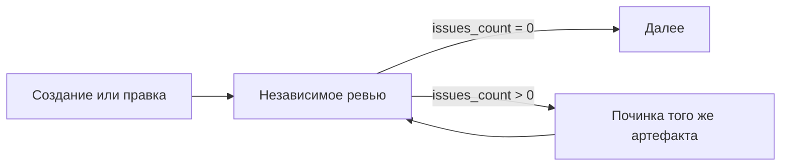

## Назначение

Используйте независимого рецензента, когда контракт workflow требует оценки участника, который не создавал артефакт. Самопроверка полезна, но не выполняет требование независимости.

## Проблема

Автор может не заметить собственные предположения. Отдельная роль даёт другую оценку, а не гарантию объективности и полноты. Судите ревью по рассуждению и первичным свидетельствам.

## Решение

Используйте доступный механизм делегирования хоста, дочерний workflow или другую действительно независимую роль. Рецензент не должен быть производителем проверяемого артефакта.

1. Завершите артефакт и зафиксируйте проверяемую редакцию.
2. Передайте требования, доступ к артефакту, существенный первичный контекст и адрес отчёта.
3. Дайте рецензенту изучить реальные источники и свидетельства проверок.
4. Не меняйте артефакт до получения этого ревью.
5. Исправьте подтверждённые замечания и верните изменённый артефакт тому же гейту.

## Контракт ревью и починки



Полный текущий набор замечаний хранится в одном каноническом отчёте. Рецензент перезаписывает его для каждой проверяемой редакции и возвращает только поле, нужное маршруту. Ноль замечаний допустим. Число описывает замечания отчёта, но не доказывает чтение всех источников или правильность артефакта.

Владелец починки читает отчёт, воспроизводит каждый подтверждённый дефект и исправляет причину. Если замечание не воспроизводится или реальный блокер мешает исправлению, сообщите причину вместо неизменённого повторного круга. Рецензент диагностирует; производитель исправляет.

## Контракт замечаний

В отчёте используйте плоский список конкретных замечаний. Метка критичности не должна разрешать игнорировать подтверждённый дефект согласованного объёма. Отделяйте наблюдения и предложения от замечаний, блокирующих приёмку.

Фрагмент схемы принадлежит ноде ревью. Подробные замечания остаются в отчёте без дублирующего массива в контексте:

```json
{
  "type": "object",
  "properties": {
    "issues_count": {
      "type": "integer",
      "minimum": 0,
      "description": "Current actionable findings in the canonical review report"
    }
  },
  "required": ["issues_count"]
}
```

## Структура

```text
[do-work] → [delegate-review] → [check-result] → clean → [next]
                                     ↓
                                  repair → [fix-issues] → [delegate-review]
```

## Реализация

### Нода делегирования ревью

Примеры предполагают объявленный и инициализированный глобальный `workspace_path` и существующие целевые ноды. Вердикту ревью не задаётся default.

```json
{
  "type": "agent-directive",
  "id": "delegate-review",
  "directive": "Obtain independent review of the frozen artifact against the actual requirements. Give the reviewer direct access to the artifact, requirements and relevant primary sources. Save the complete current findings and reasoning in {{workspace_path}}/review.md. Do not change the artifact while review is in progress. Return the report's actual actionable finding count; do not copy its detailed contents into workflow variables.",
  "completionCondition": "Independent review of the unchanged artifact completed, report saved and current finding count reported honestly",
  "inputSchema": {
    "type": "object",
    "properties": {
      "issues_count": { "type": "integer", "minimum": 0 }
    },
    "required": ["issues_count"]
  },
  "connections": { "success": "check-review-result" }
}
```

### Ключевые элементы директивы

Назовите роль рецензента, критерии приёмки, зафиксированный артефакт и адрес отчёта. Дайте контекст зависимостей, нужный для оценки. Не заменяйте первоисточники заверениями автора, не скрывайте отрицательные свидетельства и не предписывайте положительный вердикт.

### Нода проверки результата

```json
{
  "type": "condition",
  "id": "check-review-result",
  "cases": [
    {
      "when": {
        "operator": "eq",
        "left": { "contextPath": "delegate-review.issues_count" },
        "right": 0
      },
      "output": "clean"
    }
  ],
  "connections": {
    "clean": "next-step",
    "default": "fix-issues"
  }
}
```

## Реальный пример

Гейт плана читает требования и предложенный план, проверяет порядок зависимостей и проверяемость результатов, затем сохраняет полный текущий набор замечаний по каноническому адресу. Гейт результата читает созданный артефакт и относящиеся к нему свидетельства. Они оценивают разные артефакты и не заменяют друг друга.

## Антипаттерны

### Самопроверка (неправильно)

Называть оценку производителя независимым ревью. Сохраните полезную самопроверку, затем получите отдельную оценку, требуемую контрактом.

### Предвзятое делегирование (неправильно)

Просите оценить фактическое изменение, а не подтвердить «улучшения». Передавайте реальные свидетельства, включая сбои и ограничения.

### Избыточный контекст (неправильно)

Несвязанный разговор и дубли отчётов заслоняют артефакт. Дайте доступ к нужным источникам и требованиям без предписания вердикта.

## Числовая валидация

Используйте фактическое число конкретных замечаний, когда по нему выбирается маршрут. В другом workflow ту же роль может выполнять обоснованный вердикт. Число и балл не заменяют смысловое ревью; JSON Schema проверяет только форму ответа.

## Лучшие практики

- Проверяйте одну неизменённую редакцию и однозначно её обозначайте; используйте принятую вызывающей стороной версию или checksum, когда это требуется.
- Давайте прямой доступ к первичным источникам.
- Храните один канонический отчёт и сообщайте подтверждённые пробелы вместе.
- Сохраняйте обязательное независимое ревью после починки; см. [Repair Reach](/ru/docs/patterns/repair-reach/).

## Связанные паттерны

- [Цикл валидации](/ru/docs/patterns/validation-loop/)
- [Верификация шагов](/ru/docs/patterns/step-verification/)
- [Эскалация](/ru/docs/patterns/escalation/)
- [Антипаттерны](/ru/docs/patterns/anti-patterns/)
